# Storyboard — scene by scene

Frames are real renders of the project (`scripts/render-keyframes.sh`). Left: 16:9 master. Right: 9:16 vertical.

---

## S01 · بداية النور — 00:00–00:10
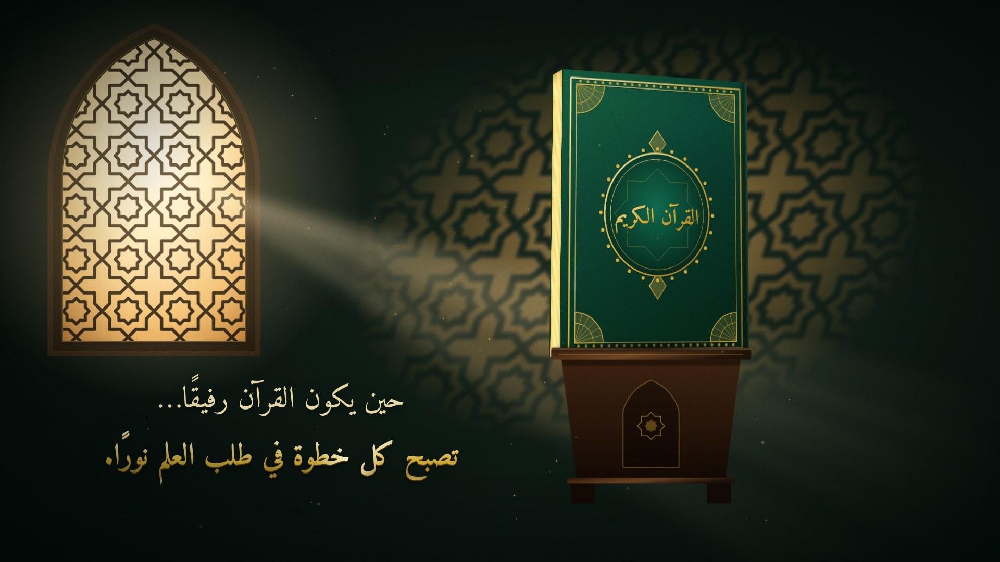 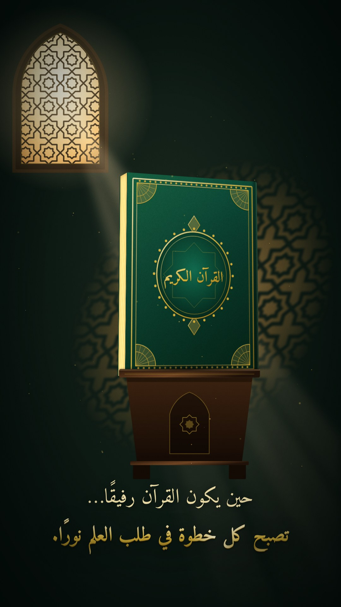

| | |
|---|---|
| **Shot** | Fade up from black on a dark room. Sunrise brightens a pointed-arch mashrabiya (0.3–5 s); its lattice is cast as a warm shadow pattern on the wall. Volumetric shafts fall across a framed illuminated panel hanging on the wall above a carved dado rail. |
| **Camera** | Slow linear dolly-in (1.00 → 1.14), background at 45 % parallax. From 8.4 s the push accelerates into the panel's shamsa, which blooms gold: the match point for S02. |
| **Object** | Wall panel (لوحة حائطية): gilded moulded frame with carved bead and corner stars, ivory mat, emerald field with tazhib border, corner pieces, faint star lattice and a scalloped central shamsa titled «القرآن الكريم». Soft cast shadow down-right; a reflection sweeps across the glass 3–8 s. |
| **Type** | Amiri. «حين يكون القرآن رفيقًا…» (champagne, 2.2 s) / «تصبح كل خطوة في طلب العلم نورًا.» (gold, 4.4 s, shine 6.2 s). |
| **Sound** | Low swell from silence; shimmer + whoosh into the cut. |

## S02 · علم بلا حدود — 00:10–00:20
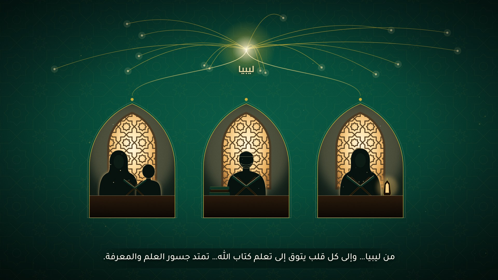 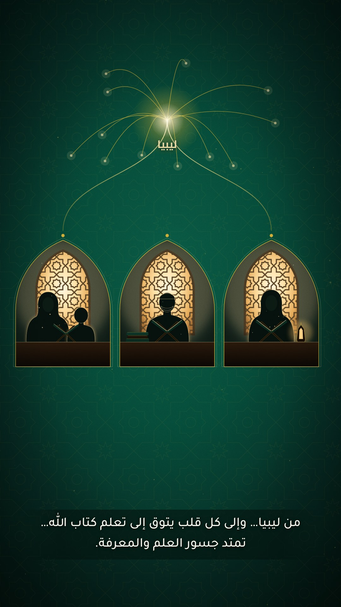

| | |
|---|---|
| **Shot** | The bloom contracts into a glowing hub labelled «ليبيا». Gold arcs draw out to a constellation of distant points (0.4–3.4 s). Three arches rise (2.8 s, staggered 0.5 s): woman studying at home · two children reading together · child learning beside his mother. Bridges draw from the hub to each arch. |
| **Camera** | Slow lateral drift right → left (60 px); arch interiors push in with foreground/background parallax. |
| **Sound** | Shimmer bed; riser into S03. |

## S03 · الكشف عن الأكاديمية — 00:20–00:31
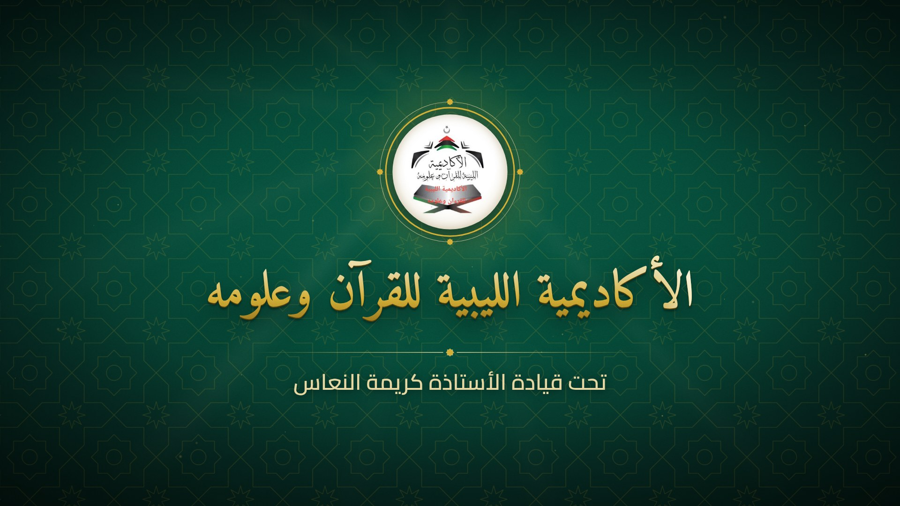 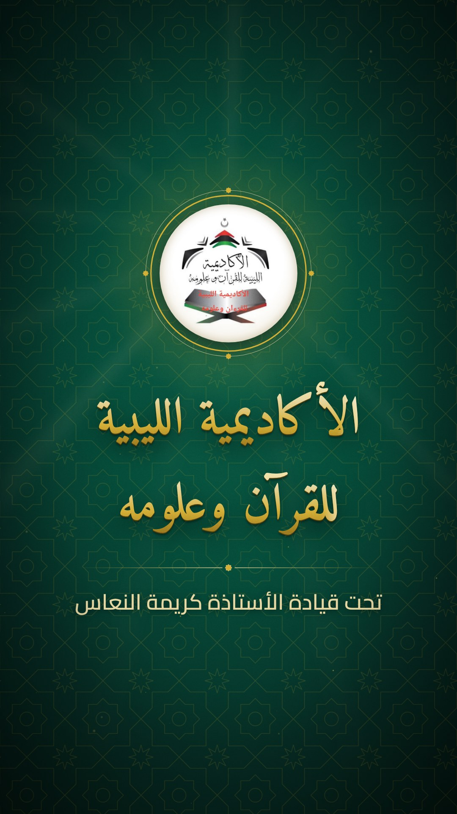

| | |
|---|---|
| **Shot** | Soft light bloom. The star-and-cross lattice draws its lines while a radial mask opens from the centre. The double gold ring draws around the academy emblem (0.2–1.8 s); emblem fades up on an ivory disc. |
| **Type** | «الأكاديمية الليبية للقرآن وعلومه» — Amiri Bold 104 px (118 px on two lines in 9:16), embossed gold with a right-to-left reveal (2.0–4.0 s) and a specular sweep (5.2–7.4 s). Divider draws (3.8 s). «تحت قيادة الأستاذة كريمة النعاس» — Cairo SemiBold (4.4 s). |
| **Camera** | 1.00 → 1.05 push over the scene; radial god-rays behind the emblem. |
| **Sound** | Soft sub impact at 20.2 s, airy sheen opens. |

## S04 · تعلم القرآن — 00:31–00:44
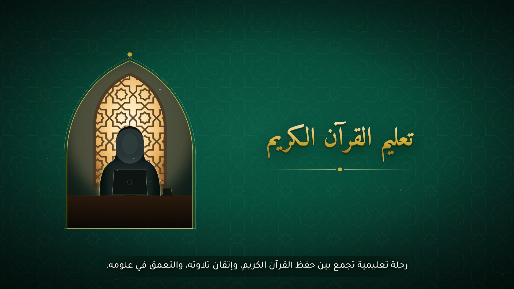 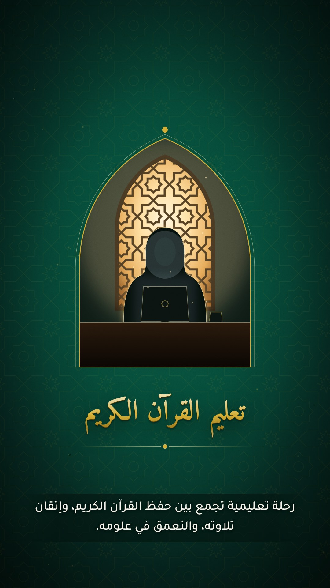

| | |
|---|---|
| **Shots** | 3 × 4.33 s. (1) woman following a tablet lesson — «تعليم القرآن الكريم». (2) woman holding the mushaf to memorise — «تحفيظ القرآن الكريم». (3) young woman reviewing back-lit study notes — «أحكام التلاوة والتجويد». |
| **Transitions** | Right-to-left gold light wipe (0.7 s), echoing the reading direction. |
| **Sound** | Page turns at the cuts, whooshes panned right → left. |

## S05 · البرامج التعليمية — 00:44–00:57
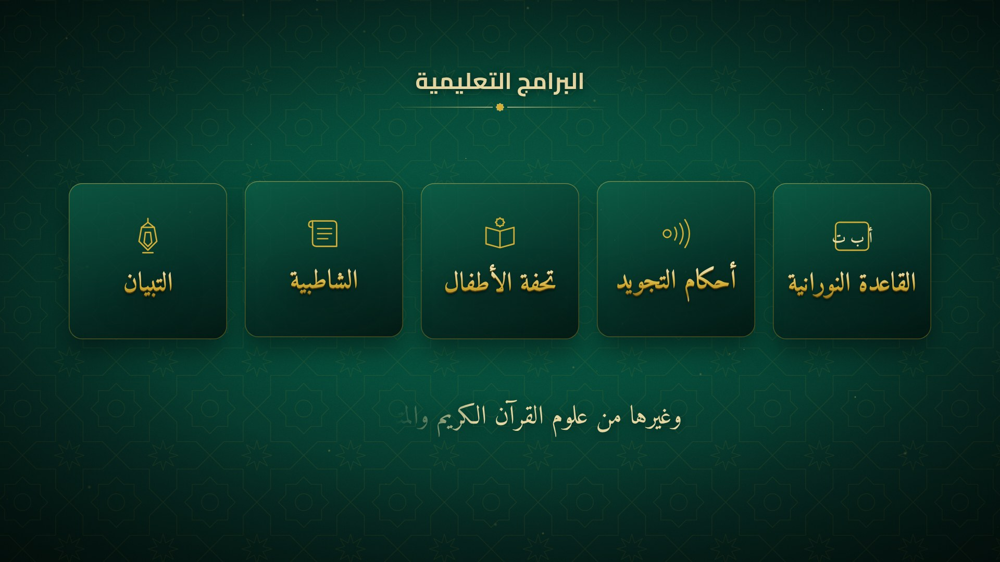 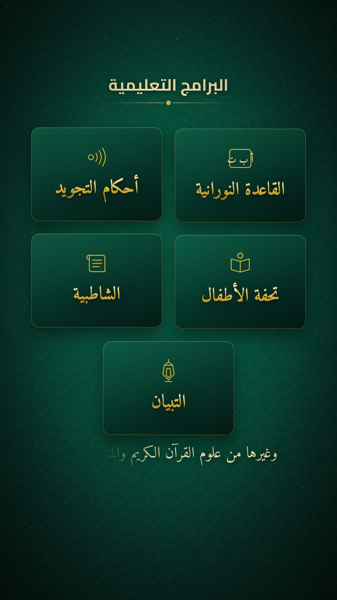

| | |
|---|---|
| **Shot** | Header «البرامج التعليمية». Every 2.2 s a program card arrives centre-stage at 1.35× (blur → sharp, icon draws itself), holds, then glides into its slot. Order follows the narration: القاعدة النورانية · أحكام التجويد · تحفة الأطفال · الشاطبية · التبيان. Footer at 11.6 s: «وغيرها من علوم القرآن الكريم والمتون العلمية». |
| **Layout** | 16:9: one right-to-left row of five. 9:16: 2 + 2 + 1 grid. Never more than one card in focus. |
| **Sound** | Soft glint per card. |

## S06 · لكل الأجيال — 00:57–01:08
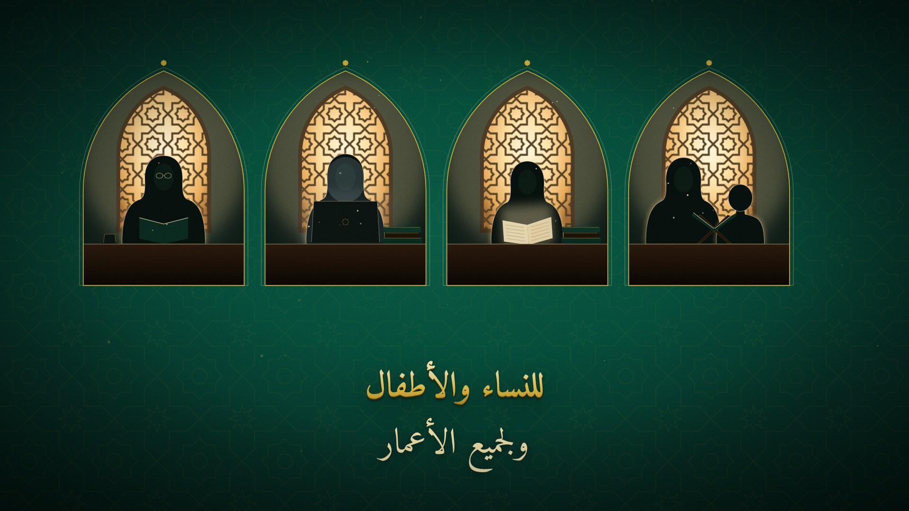 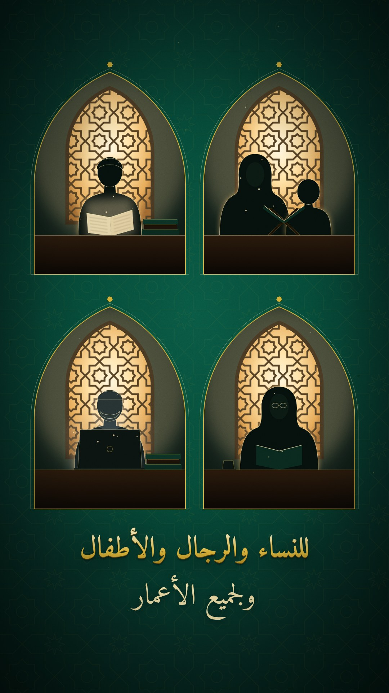

| | |
|---|---|
| **Shot** | Four arches, right to left: mother & child · young woman with notes · woman learning online · older woman reading (glasses glint). Women and children only; equal size, equal light: no generation is the "hero". |
| **Camera** | Lateral track +110 → −110 px (16:9); static 2 × 2 grid (9:16). |
| **Type** | «للنساء والأطفال» (2.2 s) / «ولجميع الأعمار» (4.4 s). |

## S07 · تعلم مجاني عن بُعد — 01:08–01:19
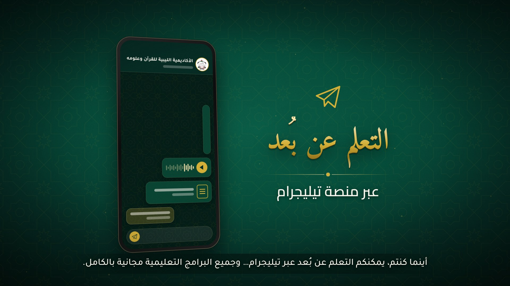 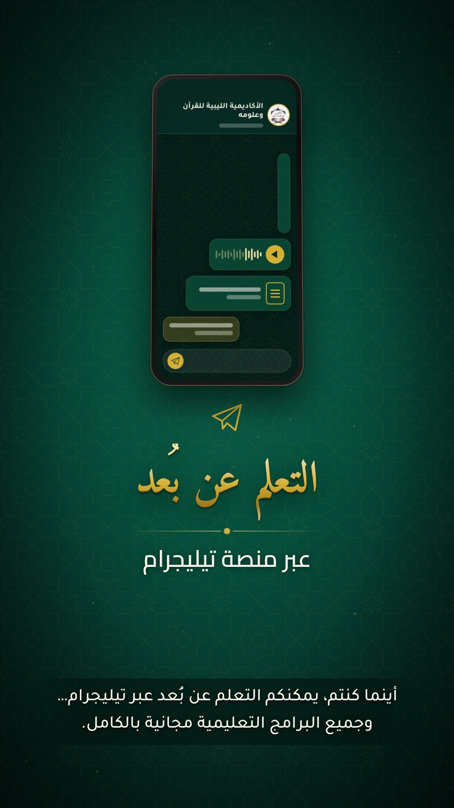
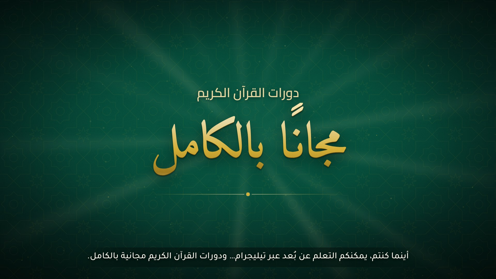 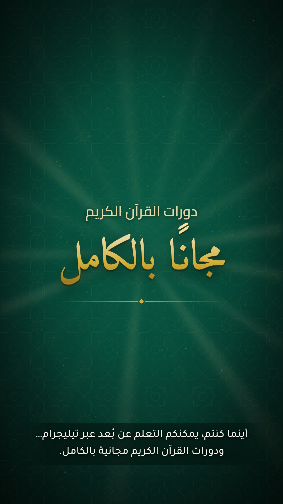

| | |
|---|---|
| **Phase 1 (0–5.4 s)** | Floating phone with a generic chat screen (academy avatar and name in the header; message rows are abstract placeholders: a lesson card, a voice note, a document, a reply). Paper-plane glyph, «التعلم عن بُعد», «عبر منصة تيليجرام». |
| **Phase 2 (6.6 s →)** | «دورات القرآن الكريم» / **«مجانًا بالكامل»** at 190 px with a radial gold particle burst, light rays and a shine pass. Lands on the narration's «مجانية بالكامل». Only the Quran courses are described as free. |
| **Sound** | Riser → soft impact + shimmer at 74.6 s. |

## S08 · الخاتمة — 01:19–01:25
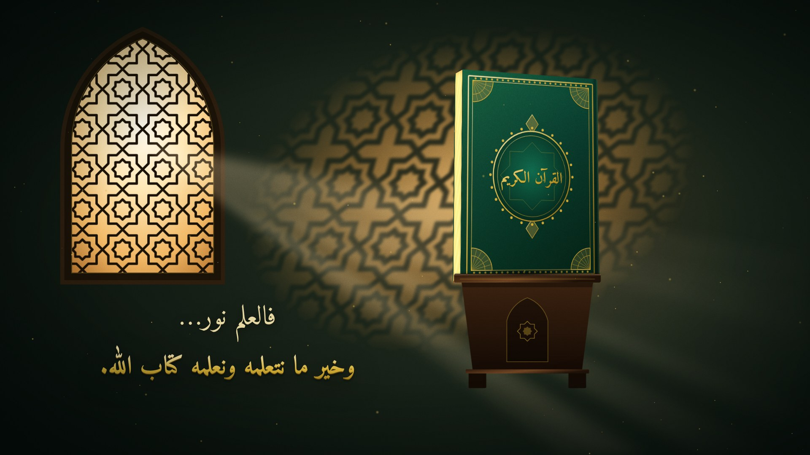 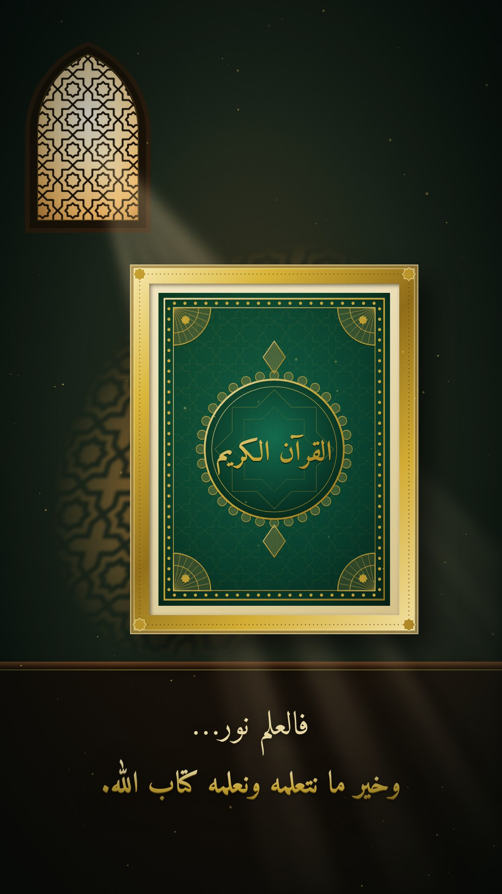

| | |
|---|---|
| **Shot** | Back to the wall panel of the opening, now in full warm light: stronger cast lattice, denser dust. Gentle pull-back (1.12 → 1.00), the opposite of S01's push-in. |
| **Type** | «فالعلم نور…» / «وخير ما نتعلمه ونعلمه كتاب الله.» |

## S09 · دعوة للانضمام — 01:25–01:32
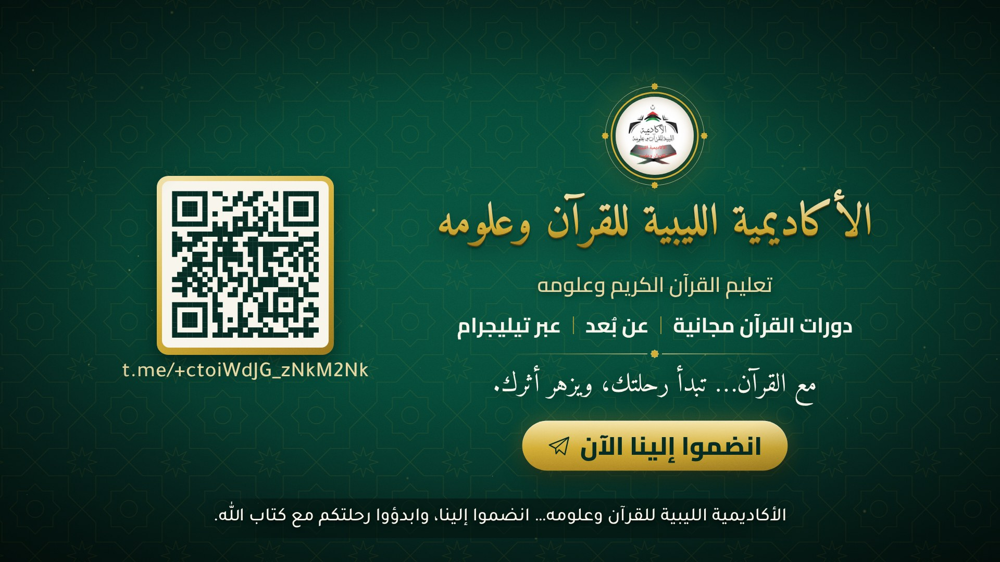 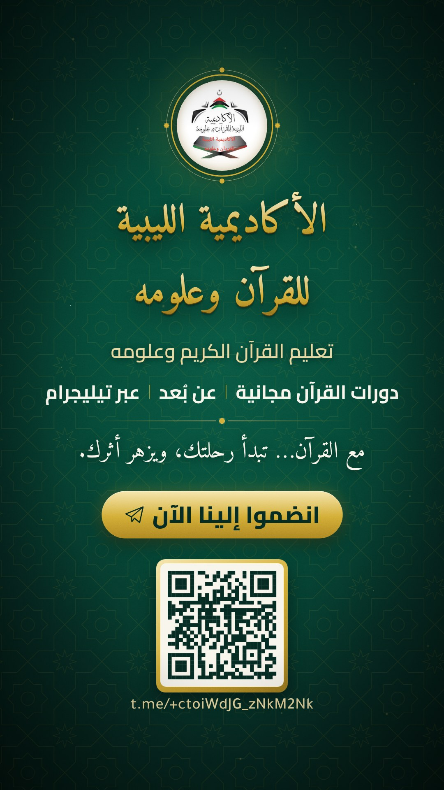

| | |
|---|---|
| **Shot** | Emblem, name (gold), «تعليم القرآن الكريم وعلومه», «دورات القرآن مجانية \| عن بُعد \| عبر تيليجرام», slogan «مع القرآن… تبدأ رحلتك، ويزهر أثرك.», pulsing gold button «انضموا إلينا الآن». The join QR (generated from the academy's Telegram invite link) and the printed link `t.me/+ctoiWdJG_zNkM2Nk` sit to the left of the column (16:9, right-to-left reading order) or below it (9:16). |
| **End** | Fade to black 6.2–7.0 s. The CTA fades in at 2.6 s and holds at full opacity for 2.9 s before the fade; to lengthen it, raise S09's `end` and `durationInSeconds` in `timeline.json` together. |
