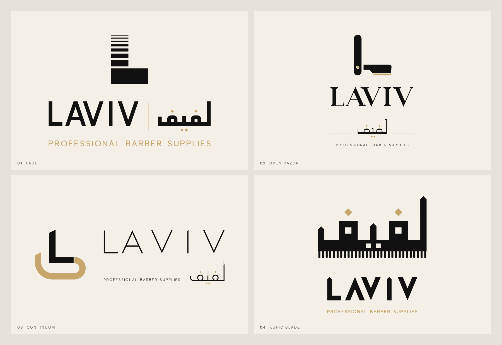
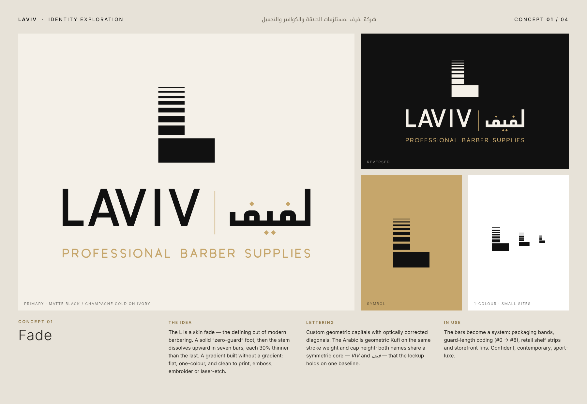
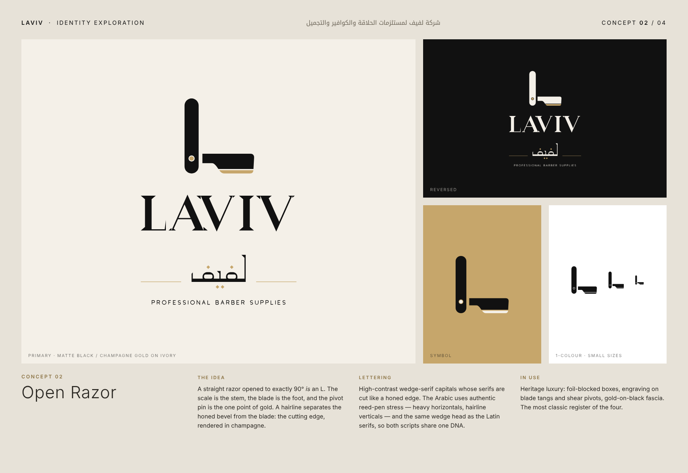
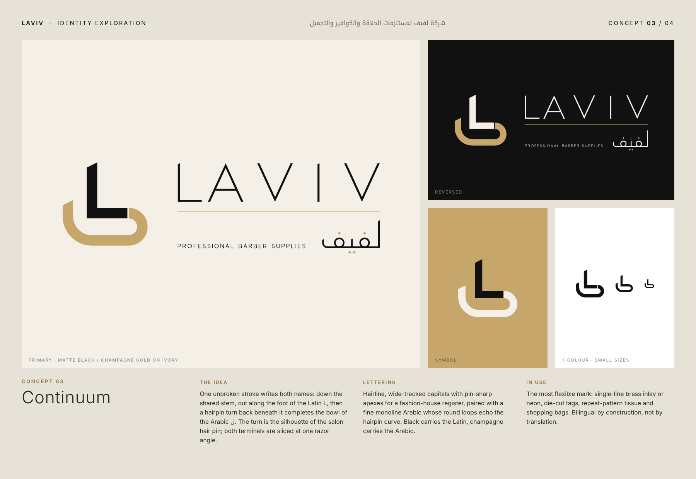
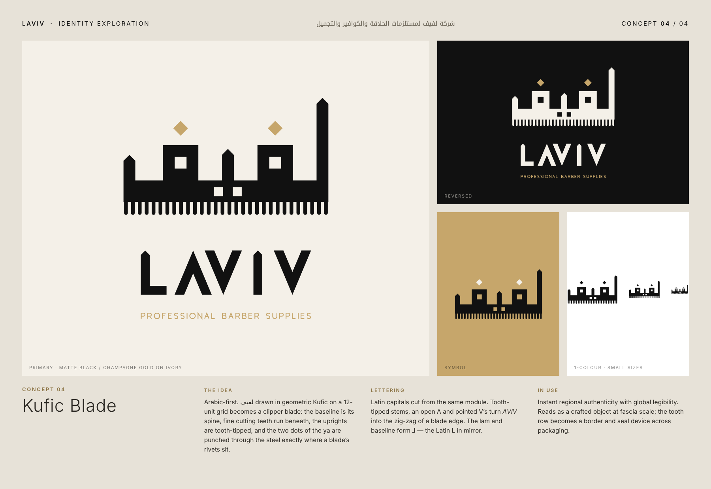

# LAVIV · لفيف — Identity Exploration

**شركة لفيف لمستلزمات الحلاقة والكوافير والتجميل**
Professional barber supplies · men's grooming · hairdressing equipment · salon accessories

Four very different logo concepts. None of them use a font. Every Latin letter, every Arabic letter and every symbol is drawn as geometry in [`src/`](src/), so the lettering is custom by construction.



| Palette | Hex |
|---|---|
| Deep matte black | `#111111` |
| Champagne gold | `#C6A66B` |
| Warm ivory | `#F4F0E8` |

---

## 01 — Fade


**Idea.** The L is a skin fade, the defining cut of modern barbering. The foot is a solid "zero-guard" block. Above it the stem fades upward in seven bars, each 30% thinner than the one below. It reads as a gradient but uses no gradient: it is flat and one colour, and it prints, embosses, embroiders and laser-etches cleanly.
**Lettering.** Geometric capitals with optically corrected diagonals, set on one baseline with geometric Kufi Arabic of the same stroke weight. Both names have a symmetric core: *VIV* and *فيف*.
**System.** Packaging bands, guard-length coding (#0 → #8), shelf strips, storefront fins.

## 02 — Open Razor


**Idea.** A straight razor opened to exactly 90° *is* an L. The scale is the stem, the blade is the foot and the pivot pin is the single gold point. A hairline separates the honed bevel from the blade, so the cutting edge shows in champagne.
**Lettering.** High-contrast capitals with wedge serifs cut like a honed edge. The Arabic follows real reed-pen contrast (heavy horizontals, hairline verticals) and uses the same wedge head as the Latin serifs.
**System.** Heritage luxury: foil-blocked boxes, engraving on tangs and shear pivots, gold-on-black fascia.

## 03 — Continuum


**Idea.** One unbroken stroke writes both names. It runs down the shared stem and out along the foot of the Latin **L**, then makes a hairpin turn back underneath to finish the bowl of the Arabic **ل**. The turn is the shape of a salon hair pin, and both ends are cut at the same razor angle. Black carries the Latin and champagne carries the Arabic.
**Lettering.** Hairline, wide-tracked capitals with sharp apexes for a fashion-house feel, paired with a fine monoline Arabic.
**System.** Single-line brass inlay or neon, die-cut tags, repeat patterns for tissue and bags.

> **Developed further →** [`concept-03-continuum/`](concept-03-continuum/README.md): refined lettering, four lockups in five colourways, construction rules, pattern, mockups and a 12-page PDF.

## 04 — Kufic Blade


**Idea.** Arabic first. لفيف is drawn in geometric Kufic on a 12-unit grid and becomes a clipper blade. The baseline is the blade's spine, fine cutting teeth run beneath it, the uprights have tooth tips, and the two dots of the ya are punched through the steel where a blade's rivets sit.
**Lettering.** Latin capitals cut from the same module: tooth-tipped stems, an open Λ and pointed V's, so *ΛVIV* zig-zags like a blade edge.
**System.** Strong regional authenticity that still reads abroad. Works as a crafted object at fascia scale, and the tooth row doubles as a border device.

---

## Files

Each `concept-XX-*/` folder contains vector SVGs with transparent backgrounds:

| File | Use |
|---|---|
| `logo-primary.svg` | Black + champagne, for light backgrounds |
| `logo-reversed.svg` | Ivory + champagne, for dark backgrounds |
| `logo-mono-black.svg` / `logo-mono-white.svg` | One colour: stamping, engraving, embroidery, fax-safe |
| `symbol-*.svg` | The standalone mark in the same four colourways |

Presentation boards are in `boards/`.

## Rebuild

```sh
node brand/laviv/src/build.mjs        # the four-concept exploration
node brand/laviv/src/book/build.mjs   # the Continuum identity book
```

This uses the Playwright/Chromium install to render the boards. The SVGs are written straight from `src/concepts.mjs`, where every proportion is a named parameter.

## Notes for refinement

- **Fade:** below about 24 px the top hairline bars merge. The chosen direction should get a simplified small-size version with four bars for favicons and app icons.
- **Kufic Blade:** at very small sizes, use the symbol without the tooth row.
- The Arabic lettering on all four concepts should be reviewed by a native Arabic calligrapher before final artwork, which is standard practice for bilingual marks.
