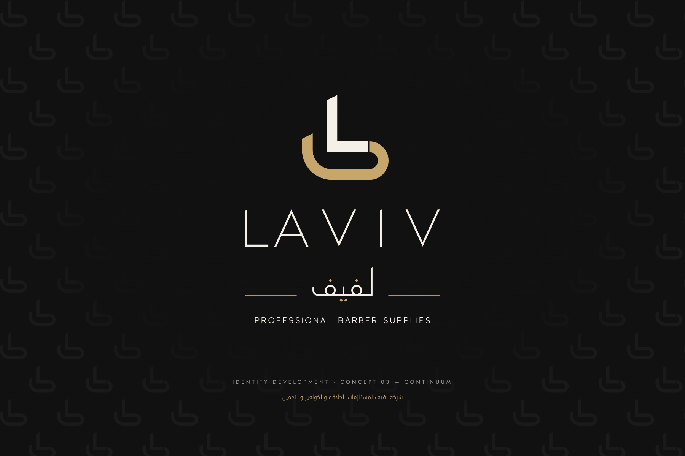
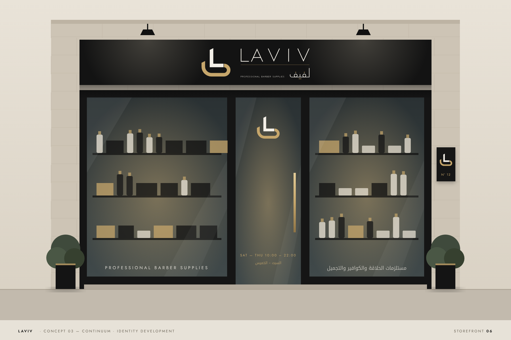
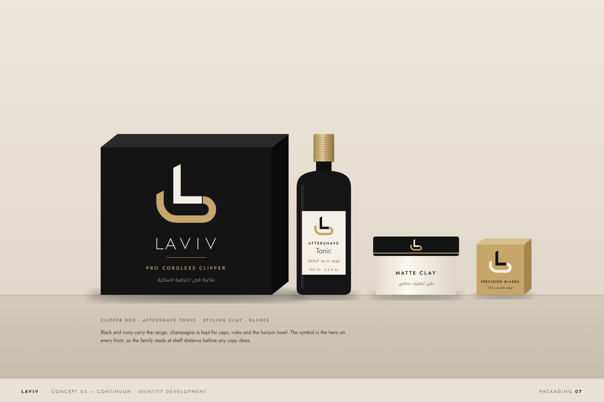
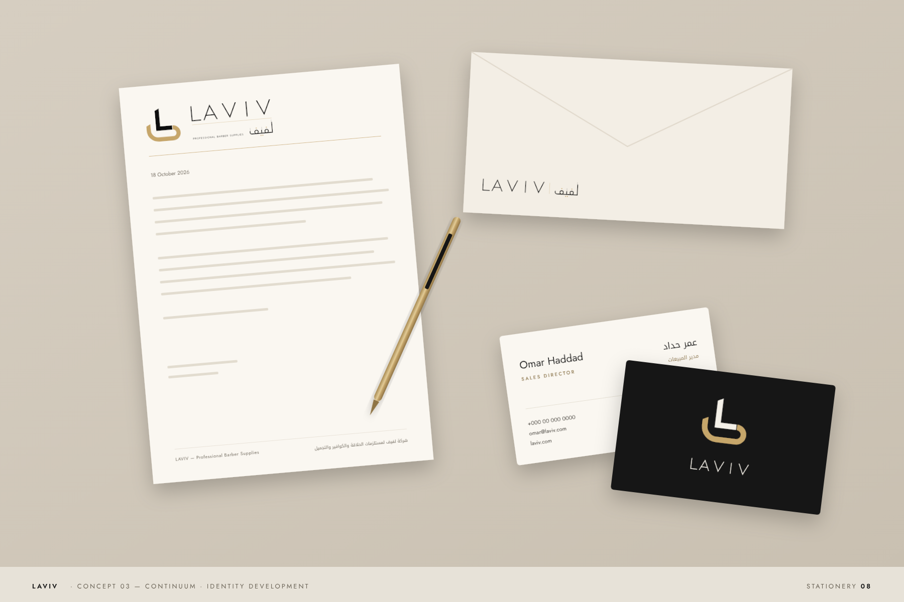
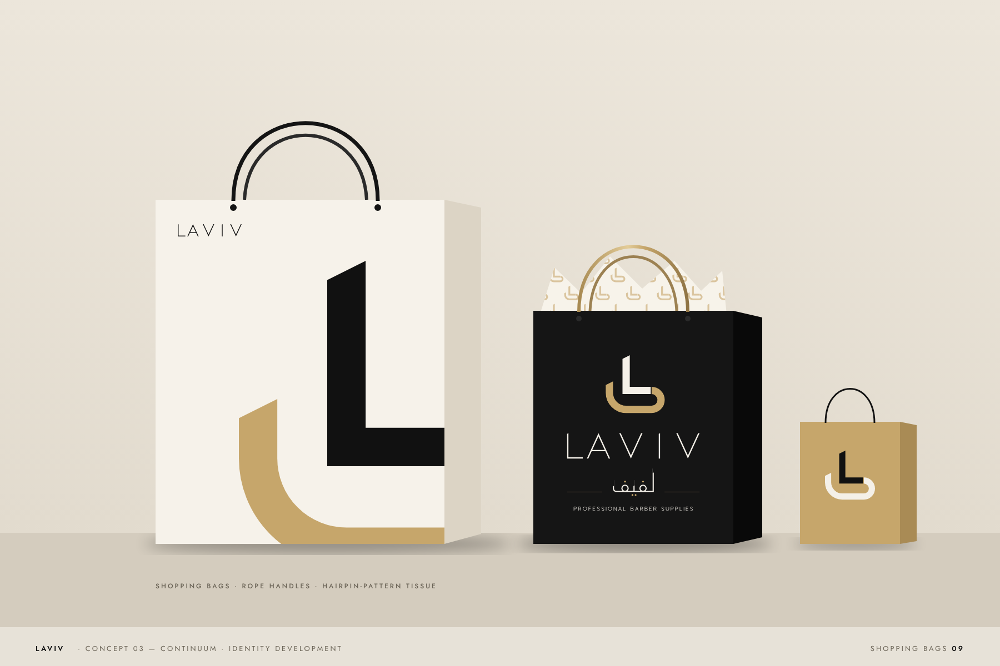
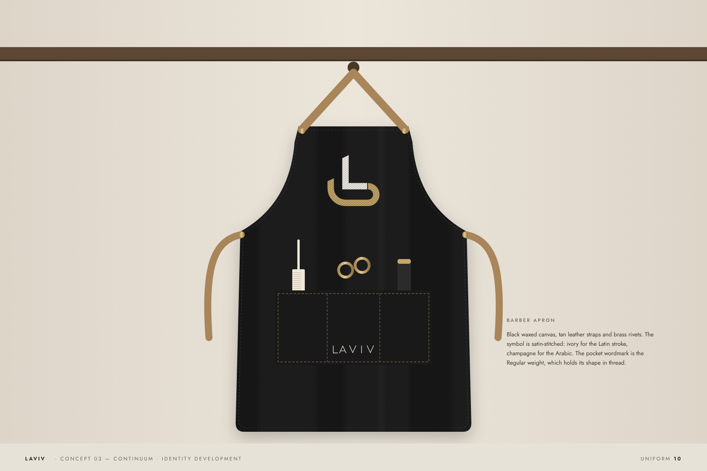
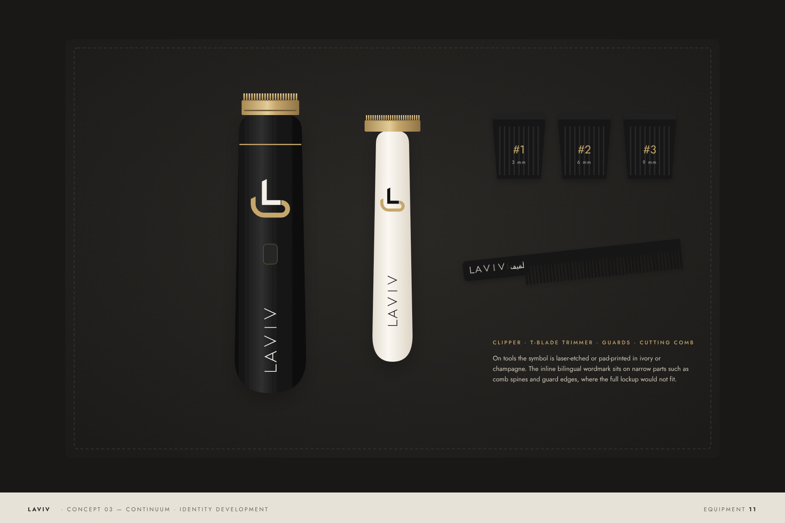
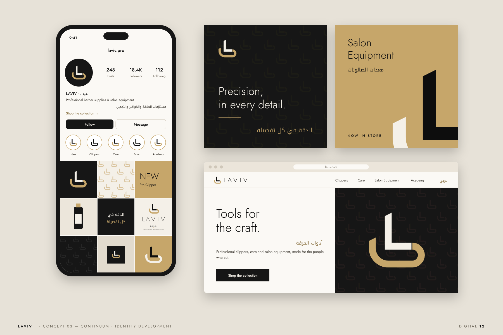

# Concept 03 — Continuum · Identity development

**[LAVIV-Continuum-Identity.pdf](LAVIV-Continuum-Identity.pdf)** is the full 12-page presentation as a single vector PDF. The same pages are in [`book/`](book/) as PNGs.



## What was developed

**Refined lettering**
- Both wordmarks now share the symbol's details. Every stem terminal in the Latin and the Arabic is cut on the symbol's 1:2 razor angle.
- The Arabic final-fa tail now turns up on a curve that echoes the symbol's bowl.
- The Latin wordmark comes in two weights. **Hairline** is for display; **Regular** is for anything below 240 px wide and for embroidery.

**Lockups** (`lockups/`)
- Four arrangements: `horizontal` (primary), `stacked`, `arabic` (Arabic-first, for RTL layouts and local signage) and `inline` (bilingual wordmark only).
- Each comes in five colourways: primary, reversed, on-gold, mono-black and mono-white. That makes 20 outlined SVGs, none of which needs a font installed.

**Rules**
- Construction is built on one module, *m*, the stroke weight. The hairpin radius is 1.3 m, the bowl radius 2.3 m, and the hand-over gap m/8.
- Clear space is 1 m on all sides. The symbol has been tested down to 20 px.
- Colour proportion is Ivory 60 / Black 30 / Champagne 10.
- Supporting typefaces are **Jost** (Latin) and **Noto Kufi Arabic**. Both are free from Google Fonts.
- A hairpin pattern is provided for tissue paper, linings and social backgrounds.

## Mockups

| | |
|---|---|
|  |  |
| **Storefront.** Black fascia with the reversed primary lockup, glass vinyl in both languages, opening hours on the door, brass plaque. | **Packaging.** Clipper box, aftershave tonic, styling clay, blade box. |
|  |  |
| **Stationery.** Letterhead, DL envelope, bilingual business cards. | **Shopping bags.** Ivory bag with a giant cropped symbol, black bag with pattern tissue, champagne gift bag. |
|  |  |
| **Uniform.** Waxed-canvas barber apron with a satin-stitched symbol. | **Equipment.** Clipper, T-blade trimmer, guards and cutting comb. |
|  | |
| **Digital.** Social profile and grid, two posts, website hero. | |

The identity pages are `02-idea`, `03-construction`, `04-lockups` and `05-colour-type-pattern`.

## Notes
- Names, phone numbers, the `laviv.com` domain, product names and opening hours in the mockups are **placeholders** to show layout. Replace them with real details before production.
- The mockups are flat vector illustrations, not photographs. For final client presentation, the SVG lockups can be dropped into photographic mockup templates.
- As with every bilingual mark, have a native Arabic calligrapher review the Arabic lettering before final artwork.

## Rebuild

```sh
node brand/laviv/src/book/build.mjs        # all pages + PDF + lockup SVGs
node brand/laviv/src/book/build.mjs 6 9    # just pages 6 and 9
```

Sources: `src/continuum.mjs` (identity system), `src/book/identity.mjs` (identity pages), `src/book/scenes.mjs` (mockups).
