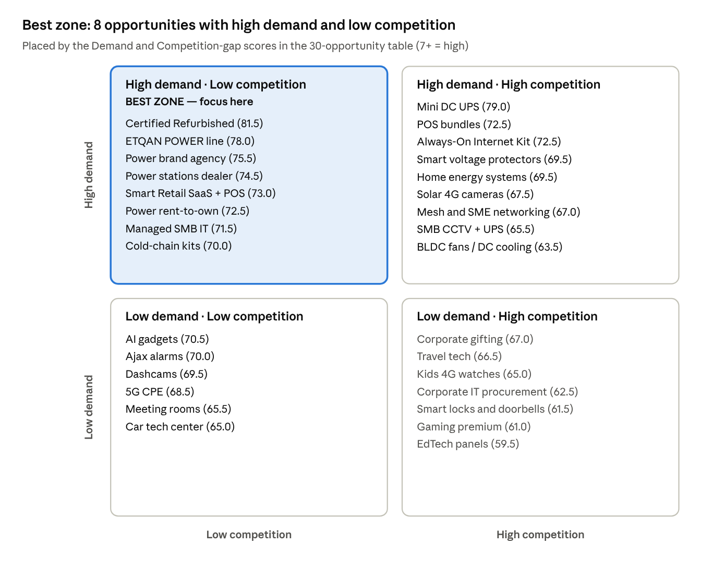

# NEW BUSINESS OPPORTUNITIES FOR AL ETQAN – LIBYA 2026–2027

Oct 6, 2026

التوصية: أكبر فرصة غير مزدحمة أمام الإتقان هي **الطاقة الاحتياطية الذكية** (Backup Power) تحت علامة خاصة ووكالة عالمية، تليها **الأجهزة المستعملة المعتمدة (Certified Refurbished)** و**حلول نقاط البيع للمحلات**. ليبيا تعيش عجزًا كهربائيًا يقارب 1,000 ميغاواط في 2026، والسوق ما زال يعتمد على مولدات الديزل وحلول بدائية.

## Executive Summary

أفضل اتجاه لتنويع الإيرادات في 2026–2027 هو تحويل الإتقان من «بائع هواتف» إلى **شركة حلول استمرارية** (Continuity): كهرباء لا تنقطع، إنترنت لا ينقطع، بيع لا يتوقف.

1. **الكهرباء هي أكبر مشكلة في ليبيا الآن (Verified):** عجز يقدَّر بأكثر من 1,000 ميغاواط، وانقطاعات تصل إلى نحو 10 ساعات يوميًا في طرابلس وبنغازي (يوليو 2026)، وحتى 36 ساعة في بعض الأحياء. مطعم واحد ينفق قرابة 10,000 دينار يوميًا على المولدات.
2. **الفجوة واضحة:** لم نجد أي دليل علني على وكيل رسمي في ليبيا لـ EcoFlow أو BLUETTI أو Ajax أو Reolink أو SUNMI، بينما هذه العلامات دخلت المغرب ومصر والخليج. في عينة من إعلانات «السوق المفتوح» ليبيا (أكتوبر 2026)، البحث عن «محطة طاقة» يعيد باور بانك فقط.
3. **الدفع الإلكتروني ينفجر (Verified):** 165,313 جهاز POS في 2025 (+15,108 خلال سنة)، و5.5 مليون بطاقة مفعّلة، والمصرف المركزي ينهي التحصيل النقدي للضرائب والجمارك. المحلات تحتاج أنظمة كاشير ومخزون تعمل مع هذا التحول.
4. **أعلى 3 فرص بالـ Score:** الأجهزة المستعملة المعتمدة (81.5)، علامة الطاقة الخاصة ETQAN POWER بدءًا بـ Mini DC UPS (79 / 78)، ومحطات الطاقة المحمولة من علامة عالمية كموزع ثم وكيل (74.5–75.5).
5. **ما نتجنبه:** Starlink (غير مرخّص في ليبيا حتى أغسطس 2026)، شواحن السيارات الكهربائية (البنزين بـ 0.15 دينار)، والأجهزة الطبية المرخّصة، والإكسسوارات العامة المشبعة.
6. **أول 3 مشاريع نوصي بها:** (1) ETQAN POWER، (2) Certified Refurbished & Trade-in، (3) Smart Retail POS للمحلات. التفاصيل في قسم MANAGEMENT RECOMMENDATION.

ملاحظة منهجية: كل رقم مصدره موقع مفتوح في قسم Sources. الأسعار المحلية هي أسعار طلب من إعلانات حقيقية وليست أسعار بيع نهائية. الهوامش والاستثمار **Estimated** وموسومة بذلك.

## شركة الإتقان اليوم (ما تم التحقق منه)

وجدنا كيانين ليبيين باسم «الإتقان» في طرابلس، والعلاقة بينهما **غير مؤكدة علنيًا**. هذا أهم سؤال يجب أن تجيب عنه الإدارة، لأن الكيان الثاني يملك خبرة أمن وشبكات تغيّر ترتيب الفرص.

| البند | الإتقان موبايل (Aletqan Mobile) | الإتقان الجديد (Aletqan Aljadeed) |
| --- | --- | --- |
| النشاط | استيراد وتوزيع هواتف وتابلت وإكسسوارات (جرابات، شواحن، سماعات، باور بانك) | حلول شبكات (ألياف ضوئية، PBX)، أنظمة أمن (كاميرات، Access Control، إطفاء)، استشارات IT |
| المصدر | الموقع يذكر التوريد من هونغ كونغ والإمارات واليابان (حسب نتيجة بحث؛ الموقع رفض الوصول المباشر) | تأسست 2001 |
| العلامات | منشورات عن Samsung S26 Ultra وA17 وA07 وiPad Pro/Air | Dahua Authorized System Integrator، AtopWell Distributor، Aucas Agent، COMMANDO Reseller، ONV، شراكات مع Cisco وHoneywell وFujikura |
| الفروع | شارع المدار (الرئيسي)، فرع أبوستة | سوق الجمعة، فشلوم، بنغازي (بالشراكة مع GTech) |
| القنوات | موقع aletqanmobile.ly، صفحة Facebook نشطة | موقع aletqanco.com |
| B2B / Wholesale | Not publicly available | مشاريع للشركات (طبيعة النشاط) |

مصادر: [aletqanco.com](https://aletqanco.com/en/)، [Yasteq listing](https://www.yasteq.com/LY/Tripoli/2020184651528145/Aletqan-Mobile.%D8%A7%D9%84%D8%A5%D8%AA%D9%82%D8%A7%D9%86-%D9%85%D9%88%D8%A8%D8%A7%D9%8A%D9%84)، [Facebook](https://www.facebook.com/Aletqanmobile/). كيانات بنفس الاسم **غير مرتبطة**: مجموعة الإتقان السعودية (aletqan.com)، شركة الإتقان للشحن السريع (aletqan.com.ly)، وEtqan Electronics في القاهرة.

**Not publicly available:** الإيرادات، حجم الجملة، وكالات حصرية، عدد الموظفين، التوزيع خارج طرابلس.

**نقاط القوة المحتملة (استنتاج):**

- سلسلة توريد قائمة من هونغ كونغ والإمارات: نفس الممر يخدم البطاريات والشبكات والـ POS.
- محلات في مواقع تجارية بطرابلس + جمهور Facebook: قناة جاهزة لاختبار منتج جديد خلال أيام.
- خبرة في الضمان والأجهزة الأصلية: أساس برنامج Certified Refurbished.
- إذا كان الإتقان الجديد جزءًا من المجموعة: فنيون تركيب، وشهادة Dahua، وعملاء شركات، وموطئ قدم في بنغازي. هذا يرفع تلقائيًا فرص Ajax والـ Managed IT والـ Always-On Kits.

**المجالات التي يسهل دخولها:** الطاقة المحمولة (نفس عميل الباور بانك)، أجهزة الإنترنت 4G/5G، الأجهزة المستعملة المعتمدة، الكاميرات الذكية، وأجهزة الـ POS للمحلات.

## Market Opportunities: مشاكل ليبية يمكن تحويلها إلى Business

ثلاث مشاكل موثّقة بالأرقام تصنع طلبًا مستمرًا وليس ترندًا: الكهرباء، التحول من النقد، وضعف الإنترنت.

| المشكلة | Verified Data | المصدر | ما يمكن أن تبيعه الإتقان |
| --- | --- | --- | --- |
| انقطاع الكهرباء | عجز \~1,000 ميغاواط (GECOL، يونيو 2026)؛ \~10 ساعات يوميًا في طرابلس وبنغازي؛ الطلب يزيد حتى 600 ميغاواط سنويًا | [Al Jazeera](https://www.aljazeera.com/economy/2026/7/29/libya-electricity-blackout-protests-expose-countrys-failing-grid) | Mini UPS، محطات طاقة، بطاريات LiFePO4، حماية جهد |
| تكلفة المولدات على المحلات | انقطاع حتى 36 ساعة في قصر بن غشير؛ مطعم ينفق \~10,000 د.ل يوميًا؛ ديزل السوق السوداء 11 د.ل/لتر مقابل 0.15 المدعوم | [Polity/Reuters, 17 Sep 2026](https://www.polity.org.za/article/libya-power-cuts-push-small-businesses-and-weary-citizens-to-brink-2026-09-17) | حلول طاقة للمحلات، حماية ثلاجات، تأجير منتهي بالتملك |
| التحول من النقد | 165,313 POS في 2025؛ 37.8 مليار د.ل عبر 288.6 مليون عملية؛ 5.5 مليون بطاقة؛ 4.29 مليون مشترك مصرفية محمولة | [Libya Observer](https://libyaobserver.ly/economy/electronic-transactions-exceed-313-billion-dinars-historic-2025-surge) | أنظمة كاشير Android، باركود، طابعات، برنامج مخزون |
| ضغط على البنية المصرفية | مليونا عملية POS في يوم واحد أسقطت النظام (مايو 2026)؛ المركزي ينهي التحصيل النقدي للضرائب والجمارك | [North Africa Post](https://northafricapost.com/97516-libya-e-payment-system-collapses-after-record-two-million-pos-transactions-in-a-single-day.html)، [Libya Herald](https://libyaherald.com/2026/05/cbl-source-to-libya-herald-cbl-moving-towards-ending-cash-collection-of-taxes-and-customs-duties-moving-solely-to-e-collections/) | POS يعمل Offline + UPS للمحل |
| ضعف الإنترنت | متوسط سرعة الجوال 22.34 Mbps (المرتبة 103 عالميًا)؛ ليبيانا تختبر 5G | [MEA Tech Watch](https://meatechwatch.com/2026/02/20/the-8-fastest-african-countries-for-mobile-internet-in-2025/) | راوترات 4G/5G، Mesh، هوائيات خارجية |
| الإنترنت الفضائي | Starlink غير مرخّص؛ المفاوضات متوقفة حتى أغسطس 2026 | [Space in Africa](https://spaceinafrica.com/?p=147423) | **لا شيء حاليًا** (مخاطرة قانونية) |
| العملة | الرسمي \~6.4 د.ل/دولار (أكتوبر 2026) بعد تخفيضين؛ الموازي أعلى | [Amwal Al Ghad](https://en.amwalalghad.com/libya-devalues-dinar-by-13-3/) | تسعير يحمي الهامش من الصرف |

**النموذج المرجعي الأقرب هو لبنان:** عندما انهارت الشبكة قفزت إضافات الطاقة الشمسية من 14 ميغاواط (2020) إلى 663 ميغاواط (2022)، وتجاوز الإجمالي 1 غيغاواط في يونيو 2023 ([pv magazine](https://pv-magazine.com/2023/06/08/lebanese-households-fight-economic-crisis-with-record-rooftop-pv-additions)). وفي مصر أثناء تخفيف الأحمال 2023–2024 ارتفعت أسعار المراوح المشحونة 70% والمولدات 48–80%، وتضاعفت مشتريات المراوح، مع انقطاع 3–5 ساعات فقط يوميًا ([Zawia3](https://zawia3.com/en/electricity-alternatives/)).

**السؤال: منتج أم حل كامل؟** الاثنان. ابدأ بمنتج سريع الدوران (Mini UPS للراوتر) لبناء الاسم، ثم بِع حلولًا مركّبة للمحلات والشركات (طاقة + إنترنت + POS + كاميرات) بعقد صيانة شهري.

## Products Libya Hasn't Caught Up With Yet

العلامات التي دخلت المغرب ومصر والخليج بوكلاء رسميين لا تملك أي وجود موثّق في ليبيا، رغم أن ليبيا هي الأشد حاجة لها بسبب الكهرباء.

### مقارنة الأسواق (الوجود الرسمي للعلامة)

| المنتج / العلامة | ليبيا | مصر | تونس | المغرب | الجزائر | الخليج |
| --- | --- | --- | --- | --- | --- | --- |
| محطات طاقة EcoFlow | لا دليل | Not publicly available | Not publicly available | موزع حصري EasyPower (منذ 2022) | Not publicly available | رسميًا منذ GITEX 2022 (الإمارات، السعودية، الكويت، عُمان) |
| محطات طاقة BLUETTI | لا دليل | Not publicly available | Not publicly available | Not publicly available | Not publicly available | متجر سعودي + مستودع في الإمارات |
| إنذار لاسلكي Ajax | لا دليل (0 إعلانات) | توظيف مدير مبيعات وطني في القاهرة | Not publicly available | موزعان منذ يوليو 2024 | Not publicly available | موزعون في السعودية |
| كاميرات Reolink | لا دليل | Not publicly available | Not publicly available | Not publicly available | Not publicly available | Trigon Gulf (الإمارات)، AAMAAL (السعودية وعُمان) |
| Dashcam 70mai | إعلانان فقط لـ«داش كام» | Not publicly available | Not publicly available | Not publicly available | Not publicly available | Sharaf DG وNoon |
| أجهزة POS من SUNMI | لا دليل على موزع | Not publicly available | Not publicly available | Not publicly available | Not publicly available | Not publicly available |
| Starlink | غير مرخّص | — | — | بدأ إجراءات الترخيص | — | — |

«لا دليل» = لم نجد وكيلًا رسميًا في البحث العلني ولا في عينة السوق المفتوح؛ لا يعني أن تاجرًا لا يستورد بشكل فردي. خانات تونس والجزائر الفارغة تعني أن البحث لم يعثر على مصدر موثوق، وهذا بحد ذاته مؤشر أن شمال أفريقيا كله ما زال مفتوحًا. المصادر: [Medias24](https://medias24.com/2022/10/31/energie-renouvelable-ecoflow-simplante-au-maroc/)، [Ajax Morocco](https://ajax.systems/fr/blog/morocco-new-distribution-partners/)، [Ajax Egypt job](https://jobs.lever.co/ajax/b19966da-a478-4a2b-b773-063c73f6ea3f)، [EcoFlow GCC](https://gulfbusiness.com/ecoflow-makes-its-official-gcc-debut-at-gitex-global/)، [Space in Africa](https://spaceinafrica.com/?p=147423).

### ما يباع فعلًا في ليبيا الآن (أسعار طلب من السوق المفتوح، سبتمبر–أكتوبر 2026)

| المنتج | سعر الطلب (د.ل) | ماذا يعني |
| --- | --- | --- |
| Mini DC UPS للراوتر (10,000mAh) | 150–200 | الطلب موجود، لا توجد علامة مسيطرة |
| Mini UPS POE 60W للكاميرات | 390–400 | شريحة محترفين بهامش أعلى |
| كاميرا شمسية V380 ثلاثية العدسات | 250–500 | منتج جديد ينتشر بدون علامة موثوقة |
| Huawei 5G CPE | 1,250–3,000 | الناس تدفع كثيرًا لإنترنت أفضل |
| Huawei Mesh (3 قطع) | 900 | Mesh موجود لكن نادر |
| منظومة نقاط بيع كاملة | 2,500–3,600 | سوق مجزأ من مبرمجين محليين |
| قارئ باركود / طابعة Xprinter | 495 / 375 | هامش جيد على الملحقات |
| قفل ذكي Imou | 1,450 | فئة ضيقة لكن بسعر مرتفع |
| سبورة تفاعلية | 9,000–12,000 | موجود «وكيل حصري» محلي |
| ثلاجة EcoFlow محمولة | 4,594 | منتج مميز يصل فرديًا |
| Dashcam | 150–200 | إعلانان فقط = سوق غير مطوّر |

المصدر: عينة بحث في [السوق المفتوح ليبيا](https://ly.opensooq.com/) بتاريخ 6 أكتوبر 2026 (الصفحة الأولى لكل كلمة بحث، نحو 30 إعلانًا). التجارة في ليبيا تتم أساسًا عبر Facebook، لذلك هذه مؤشرات وليست حجم سوق.

### المنافسون المباشرون في طرابلس

- [بن خولة](https://bk.com.ly/): الموزع الرسمي لـ TCL، هواتف ولابتوبات وإكسسوارات، فرع جملة في كريمية. لا طاقة، لا أمن، لا POS.
- [الامتياز](https://imtiazmobile.ly/): جملة هواتف + Anker وBaseus. لا طاقة منزلية ولا شبكات.
- [البارق](https://albarik.ly/electronics-en.html): يوزع Hikvision وNetis وKemei. المنافس الأقرب في الأمن والشبكات.
- تواصل ليبيا: موزع لعلامات هواتف عالمية.

الخلاصة: منافسو الهواتف لم يتنوعوا بعد نحو الطاقة والحلول، وهذه نافذة زمنية قصيرة (12–18 شهرًا تقديرًا).

## Emerging Products: نمو مستمر وليس ترندًا

الفئات التي تجمع بين نمو عالمي موثّق وحاجة ليبية واضحة هي الطاقة المحمولة والـ AI wearables؛ الأولى للبيع الآن، والثانية لاختبار صغير.

| الفئة | إشارة النمو (Verified) | مستوى النضج في ليبيا | الحكم |
| --- | --- | --- | --- |
| محطات الطاقة المحمولة (LiFePO4) | تقديرات السوق العالمية تتراوح بين 0.7 و1.5 مليار دولار في 2025–2026 مع CAGR بين 6.6% و17.7% حسب المصدر ([Coherent MI](https://www.coherentmi.com/press-releases/portable-power-station-market)) | شبه غائبة رغم الأزمة | ادخل الآن |
| Mini UPS للشبكات والكاميرات | منتجات متعددة الجهد 5/9/12V + PoE تظهر في 2025 ([CNX Software](https://www.cnx-software.com/2025/03/21/mini-ups-with-5v-9v-12v-dc-and-poe-output-could-be-useful-for-routers-security-cameras-sbcs-and-mini-pcs/)) | موجود بلا علامة | ادخل الآن بعلامة خاصة |
| نظارات AI | Meta/EssilorLuxottica باعت أكثر من 7 ملايين وحدة في 2025، أي 3 أضعاف 2024 ([UploadVR](https://uploadvr.com/meta-essilorluxottica-sold-7-million-smart-glasses-in-2025/)) | غائبة | اختبار صغير (التوفر والدعم العربي محدود) |
| مسجلات AI للاجتماعات | Plaud تعلن تجاوز مليون مستخدم في 170+ دولة ([Plaud](https://in.plaud.ai/blogs/news/your-go-to-ai-voice-recorder-plaud-note-just-cracks-10-million-in-sales)) | غائبة | اختبار B2B للمحامين والأطباء |
| كاميرات 4G شمسية | بدأت تظهر في إعلانات ليبية خلال أسابيع | بداية انتشار | ادخل بسرعة قبل التشبع |
| Fixed Wireless 5G | ليبيانا تختبر 5G | مبكر | جهّز شراكة مع المشغل |
| الأجهزة المعتمدة (Refurbished) | فئة عالمية نامية (Back Market، Apple Certified) | سوق مستعمل ضخم لكن غير رسمي | ادخل الآن |

ما استبعدناه عمدًا: الـ Gadgets الفيروسية على TikTok ذات العمر القصير، والساعات الذكية الرخيصة (تُباع بـ 45–100 د.ل في السوق = مشبعة). Google Trends لليبيا: Not publicly available بحجم موثوق لهذه المصطلحات.

## الجدول الرئيسي: 30 فرصة مرتبة

أعلى 9 فرص من أصل 30 تقع في 3 عناقيد فقط: الطاقة الاحتياطية، الأجهزة المعتمدة، وتقنية المحلات. \[L\] = منخفضة المخاطر، \[M\] = متوسطة، \[H\] = عالية النمو (10 في كل فئة). الاستثمار والهامش **Estimated** (هامش إجمالي قبل المصاريف الثابتة).

| Rank | Business | Category | Why Libya? | Investment (USD) | Expected Margin | Competition | Difficulty | Growth Potential | Score |
| --- | --- | --- | --- | --- | --- | --- | --- | --- | --- |
| 1 | \[H\] Certified Refurbished & Trade-in (هواتف، آيباد، لابتوب) | Circular / Mobile | سوق مستعمل ضخم بلا ضمان (iPhone 16 Pro Max مستعمل 7,500–7,950 د.ل) | 40–80k | 15–25% | متوسطة (أفراد) | متوسطة | عالية | 81.5 |
| 2 | \[L\] Mini DC UPS للراوتر والكاميرات (ETQAN) | Power | الإنترنت ينقطع مع الكهرباء؛ يباع 150–200 د.ل | 3–6k | 40–55% | متوسطة، بلا علامة | منخفضة | متوسطة | 79.0 |
| 3 | \[H\] علامة طاقة خاصة ETQAN POWER (UPS، باور بانك، محطات 0.3–1 kWh) | Power / OEM | لا توجد علامة محلية موثوقة للطاقة | 25–60k | 35–50% | منخفضة | متوسطة | عالية جدًا | 78.0 |
| 4 | \[H\] وكالة حصرية لعلامة محطات طاقة (BLUETTI أو EcoFlow) | Power / Distribution | لا وكيل موثّق في ليبيا | 50–150k | 20–30% | منخفضة | عالية | عالية جدًا | 75.5 |
| 5 | \[M\] موزع معتمد لمحطات الطاقة (Dealer) | Power | عجز 1,000 ميغاواط + مولدات مكلفة | 15–30k | 20–30% | منخفضة | متوسطة | عالية | 74.5 |
| 6 | \[H\] Smart Retail: POS + برنامج مخزون باشتراك شهري | Retail Tech / SaaS | 165k جهاز POS مصرفي بلا أنظمة كاشير موحدة | 40–100k | 40–60% (اشتراك) | متوسطة | عالية | عالية | 73.0 |
| 7 | \[M\] باقات POS جاهزة (Android POS + باركود + طابعة + UPS) | Retail Tech | منظومات تباع 2,500–3,600 د.ل من مبرمجين أفراد | 15–30k | 25–35% | متوسطة | متوسطة | عالية | 72.5 |
| 8 | \[L\] Always-On Internet Kit (راوتر 4G/5G + Mini UPS) | Networking | سرعة 22 Mbps + انقطاعات | 5–10k | 25–35% | متوسطة | منخفضة | متوسطة | 72.5 |
| 9 | \[H\] طاقة للمحلات بالتأجير المنتهي بالتملك | Power / Finance | محل يدفع آلاف الدنانير شهريًا على الديزل | 50–100k | 30–45% | منخفضة جدًا | عالية (تحصيل) | عالية | 72.5 |
| 10 | \[H\] عقود IT شهرية للشركات الصغيرة (شبكة + كاميرات + UPS + صيانة) | Managed Services | الشركات تشتري قطعًا بلا مسؤول واحد | 20–40k | 40–60% | متوسطة | متوسطة | عالية | 71.5 |
| 11 | \[L\] ركن AI Gadgets (مسجلات AI، سماعات ترجمة، نظارات) | New Tech | غائبة تمامًا؛ تبني صورة مبتكرة | 3–6k | 25–40% | منخفضة جدًا | منخفضة | متوسطة | 70.5 |
| 12 | \[M\] حماية التبريد (حساسات حرارة + تنبيه + بطارية) | IoT B2B | تلف الأغذية والأدوية مع الانقطاع | 10–20k | 35–50% | منخفضة جدًا | متوسطة | متوسطة | 70.0 |
| 13 | \[M\] أنظمة إنذار لاسلكية Ajax | Security | بطاريات تعمل سنوات + اتصال خلوي = تعمل أثناء الانقطاع | 20–40k | 30–40% | منخفضة جدًا | عالية | عالية | 70.0 |
| 14 | \[L\] حمايات جهد ذكية ومقابس ذكية | Power | عودة الكهرباء بارتفاع جهد تتلف الأجهزة | 3–5k | 35–50% | متوسطة | منخفضة | متوسطة | 69.5 |
| 15 | \[L\] Dashcams (70mai / DDPAI) | Automotive | 3.26 مليون مركبة مسجلة (2020)؛ إعلانان فقط | 3–6k | 30–45% | منخفضة | منخفضة | متوسطة | 69.5 |
| 16 | \[H\] أنظمة طاقة منزلية مركّبة (Hybrid Inverter + LiFePO4 + ألواح) | Energy | نموذج لبنان | 80–200k | 15–25% | متوسطة (مركّبون صغار) | عالية | عالية جدًا | 69.5 |
| 17 | \[H\] أجهزة 5G CPE للإنترنت المنزلي | Networking | Huawei 5G CPE يباع 1,250–3,000 د.ل | 20–40k | 15–25% | متوسطة | متوسطة | عالية (مرتبطة بـ 5G) | 68.5 |
| 18 | \[L\] كاميرات 4G شمسية | Security | بلا أسلاك وبلا كهرباء | 3–6k | 35–50% | متوسطة ومتزايدة | منخفضة | متوسطة | 67.5 |
| 19 | \[M\] هدايا الشركات التقنية بشعار العميل | Corporate | مواسم رمضان والأعياد، شركات نفط ومصارف | 10–20k | 30–45% | متوسطة | منخفضة | متوسطة | 67.0 |
| 20 | \[M\] Mesh Wi-Fi وشبكات المكاتب الصغيرة | Networking | فلل ومكاتب بها مناطق ميتة | 10–20k | 20–35% | متوسطة | متوسطة | متوسطة | 67.0 |
| 21 | \[L\] Travel Tech (GaN، محولات، متتبعات Find My) | Travel | سفر متكرر إلى تونس وتركيا ومصر | 3–5k | 35–50% | متوسطة | منخفضة | منخفضة | 66.5 |
| 22 | \[M\] تجهيز قاعات الاجتماعات (Yealink / Jabra) | B2B | شركات نفط، منظمات، مصارف | 15–30k | 20–30% | منخفضة | متوسطة | متوسطة | 65.5 |
| 23 | \[M\] باقات كاميرات للمحلات مع UPS | Security | طلب كبير لكن الفنيون كثيرون | 10–25k | 20–30% | عالية | متوسطة | متوسطة | 65.5 |
| 24 | \[M\] مركز تركيب تقنيات السيارات (Dashcam، TPMS، شاشات CarPlay) | Automotive | سيارات مستعملة مستوردة بلا تقنيات حديثة | 30–60k | 30–45% | متوسطة | متوسطة | متوسطة | 65.0 |
| 25 | \[L\] ساعات أطفال 4G بـ GPS | Wearables | أمان الأطفال | 3–5k | 30–45% | متوسطة | منخفضة | منخفضة | 65.0 |
| 26 | \[L\] مراوح BLDC مشحونة وتبريد DC | Power | صيف 48°C + انقطاع | 8–15k | 20–30% | متوسطة | منخفضة | موسمية | 63.5 |
| 27 | \[H\] توريد IT للشركات والتأجير | B2B | مناقصات كبيرة لكن هامش ضيق | 50–150k | 8–15% | متوسطة | عالية | متوسطة | 62.5 |
| 28 | \[M\] أقفال ذكية وأجراس فيديو (Aqara / Imou) | Smart Home | فئة ضيقة، قفل Imou بـ 1,450 د.ل | 10–20k | 30–40% | متوسطة | متوسطة | منخفضة | 61.5 |
| 29 | \[L\] إكسسوارات ألعاب فاخرة | Gaming | سوق PlayStation نشط | 5–10k | 20–30% | عالية | منخفضة | منخفضة | 61.0 |
| 30 | \[H\] شاشات تفاعلية للمدارس | EdTech | اتفاق Classera لـ 2.25 مليون طالب (2025) | 40–80k | 20–30% | متوسطة (وكيل حصري محلي) | عالية (مناقصات) | متوسطة | 59.5 |

تفصيل درجات العوامل الثمانية لكل فرصة في قسم المنهجية في آخر التقرير. مصادر الأرقام الليبية: [CEIC](https://ceicdata.com/en/indicator/libya/motor-vehicle-registered) للمركبات، [ALECSO](https://n.alecso.org/en/n/60-agreement-for-operating-classera-smart-e-learning-system-signed-at-alecso) للتعليم.

## Opportunity Matrix

**BEST ZONE (طلب مرتفع / منافسة منخفضة):** 8 فرص، 4 منها في الطاقة الاحتياطية، وهذا سبب تركيز التوصية على ETQAN POWER. الـ Mini UPS يقع في المنطقة المزدحمة لأن منتجات بلا علامة تباع فعلًا؛ الفوز فيه يكون بالعلامة والضمان، وهو بوابة الدخول الأرخص إلى المنطقة الأفضل.

## TOP 10 OPPORTUNITIES FOR AL ETQAN (1–5)

دمجنا الفرص المتداخلة في الجدول (مثل الـ Dealer والوكالة) لتكون العشر أعمالًا مختلفة فعلًا. كل سعر بالدينار غير منسوب لإعلان هو Estimated على أساس 7 د.ل/دولار (تحوّط من السوق الموازي).

### 1. Certified Refurbished & Trade-in — Score 81.5

| البند | التفاصيل |
| --- | --- |
| What is it? | برنامج «الإتقان Certified»: أجهزة iPhone وSamsung وiPad مستعملة Grade A، فحص موثّق من 40+ نقطة، بطارية جديدة إذا قلّت عن 85%، ضمان 6–12 شهرًا، واستبدال القديم بالجديد (Trade-in). |
| Why now? | تخفيضا الدينار (أبريل 2025 ثم 2026) رفعا سعر الجديد، فيتجه المشتري للمستعمل. |
| Why Libya? | إعلانات المستعمل مليئة بـ«بطارية 76%» و«مش مفتوح» و«ضمان أسبوع»: مشكلة ثقة واضحة. لم نجد بائعًا منظمًا بضمان حقيقي. |
| Target Customers | طلاب وموظفون، ومن يريد iPhone بميزانية أقل، وشركات تشتري أجهزة لموظفيها. |
| Competition | أفراد ومحلات صغيرة على Facebook والسوق المفتوح. لا منافس منظّم موثّق. |
| Pricing | مرجع حقيقي: iPhone 16 Pro Max مستعمل يُعرض بـ 7,500–7,950 د.ل. نسخة معتمدة بضمان تُسعّر في أعلى النطاق، وأقل من الجديد بـ 15–25%. |
| Investment | 40–80 ألف دولار: 60–100 جهاز، محطة فحص وبرمجيات، بطاريات، مخصص ضمان. |
| Margin | 15–25% إجمالي (Estimated)، وأعلى في الـ Trade-in لأن الشراء محلي. |
| Suppliers | مورّدو Grade A في دبي وهونغ كونغ (نفس قنوات الإتقان الحالية) + أجهزة الـ Trade-in من العملاء. |
| Entry Strategy | ابدأ بـ iPhone فقط (3 موديلات)، ركن مستقل في فرع المدار، تقرير فحص مطبوع مع كل جهاز، ثم أضف Samsung واللابتوب. |
| Risks | أجهزة مسروقة أو مقفلة iCloud (الحل: فحص IMEI وإثبات ملكية)، تكلفة الضمان، هبوط أسعار الموديلات القديمة. |
| First 90 Days | 1–30: إجراءات الفحص والضمان. 31–60: أول 50 جهازًا + حملة Facebook. 61–90: إطلاق Trade-in وقياس نسبة المرتجعات. |

### 2. ETQAN POWER — علامة طاقة خاصة تبدأ بـ Mini DC UPS — Score 79 / 78

| البند | التفاصيل |
| --- | --- |
| What is it? | خط منتجات باسم الشركة: Mini DC UPS (5/9/12V، 10,000–15,600mAh) للراوتر والـ ONT، ثم UPS PoE للكاميرات، ثم محطات LiFePO4 من 300 إلى 1,000Wh. |
| Why now? | الانقطاعات تزداد في 2026، وصيف 2027 هو موسم الذروة القادم. |
| Why Libya? | المنتج يباع فعلًا (150–200 د.ل) لكن بلا علامة ولا ضمان. الثقة في البطارية هي ما يبني العلامة. |
| Target Customers | الأسر، محلات الهواتف (جملة)، فنيو تركيب الإنترنت والكاميرات، مزوّدو الإنترنت. |
| Competition | منتجات مجهولة مثل SKE وماركات بلا اسم. |
| Pricing | Mini UPS: 159–189 د.ل. UPS PoE: 349–399 د.ل (مطابق للسوق مع ضمان سنة). |
| Investment | الاختبار: 3–6 آلاف دولار (300–500 وحدة). الخط الكامل: 25–60 ألف دولار. |
| Margin | سعر المصنع 7–15 دولارًا للوحدة على Alibaba (Verified listings) → بعد الشحن والجمارك \~11–20 دولارًا → هامش 40–55% (Estimated). |
| Suppliers | مصانع شنتشن على Alibaba (ظهرت في البحث: Shenzhen Richroc Electronic، Jiangxi Nuovolt New Energy). اطلب شهادات UN38.3 وMSDS وزيارة مصنع. |
| Entry Strategy | بيع جملة لـ 50 محل هواتف + فنيي الإنترنت في طرابلس ومصراتة وبنغازي، مع عرض في الفروع وفيديو «النت ما يقطعش». |
| Risks | جودة الخلايا وخطر الحرائق، قيود شحن الليثيوم (بحريًا فقط غالبًا)، نسخ المنافسين. |
| First 90 Days | 1–30: عينات من 3 مصانع واختبار ساعات التشغيل. 31–60: أول طلبية بالاسم والتغليف العربي. 61–90: بيع جملة + قياس المرتجعات. |

### 3. محطات طاقة من علامة عالمية: Dealer الآن ثم وكالة حصرية — Score 74.5 / 75.5

| البند | التفاصيل |
| --- | --- |
| What is it? | بيع محطات 1–2kWh من BLUETTI أو EcoFlow مع ألواح شمسية محمولة، ثم التفاوض على الوكالة الوطنية. |
| Why now? | العلامتان تتوسعان إقليميًا (EcoFlow في Middle East Energy 2026، BLUETTI تبحث عن موزعين في أفريقيا). |
| Why Libya? | لا وكيل موثّق؛ ثلاجة EcoFlow واحدة تظهر في الإعلانات بـ 4,594 د.ل = طلب موجود بلا معروض. |
| Target Customers | أسر الطبقة المتوسطة، عيادات ومكاتب، محلات صغيرة، هواة الرحلات. |
| Competition | استيراد فردي وانفرترات وبطاريات سيارات (انفرتر 3000W بـ 600–2,250 د.ل)، ومولدات البنزين. |
| Pricing | سعر المحطات في ليبيا: Not publicly available. التقدير لمحطة 1kWh بعلامة عالمية: 3,000–4,500 د.ل (Estimated). |
| Investment | Dealer: 15–30 ألف دولار (20–40 وحدة + عرض). وكالة: 50–150 ألف دولار. |
| Margin | 20–30% (Estimated)، وترتفع مع الوكالة. |
| Suppliers | BLUETTI (مستودع الإمارات)، EcoFlow (صفحة Cooperation)، بدائل: Anker SOLIX وJackery. |
| Entry Strategy | اطلب Dealer في طرابلس مع حق أولوية على الوكالة الوطنية بعد 12 شهرًا مقابل أهداف مبيعات. ثم وكلاء فرعيون في مصراتة وبنغازي. |
| Risks | العلامة قد تغطي ليبيا من دبي، استيراد موازٍ (Grey)، تقلب الصرف، تكلفة الضمان. |
| First 90 Days | 1–30: تواصل مع العلامتين. 31–60: طلبية تجريبية + منطقة عرض تشغّل ثلاجة وراوتر. 61–90: تقسيط بالشراكة مع مصرف. |

### 4. Smart Retail POS (باقات جاهزة + اشتراك برنامج) — Score 72.5 / 73

| البند | التفاصيل |
| --- | --- |
| What is it? | «كاشير جاهز في يوم»: Android POS (SUNMI أو iMin) + قارئ باركود + طابعة 80mm + درج نقود + Mini UPS، مع برنامج مبيعات ومخزون عربي باشتراك شهري. |
| Why now? | المصرف المركزي يدفع نحو الدفع الإلكتروني، والمحلات تحتاج فواتير ومخزونًا منظمًا. |
| Why Libya? | المنظومات الحالية تباع من مبرمجين أفراد بـ 1,000–3,600 د.ل بلا دعم مؤسسي. |
| Target Customers | بقالات، مقاهٍ، صيدليات، محلات ملابس، مطاعم صغيرة. |
| Competition | مبرمجون محليون، أنظمة سحابية ناشئة (إعلان من 50 د.ل). |
| Pricing | الباقة: 2,900–3,900 د.ل + اشتراك 100–200 د.ل شهريًا (Estimated). |
| Investment | 15–30 ألف دولار مخزون + 10–40 ألف دولار لشراكة برمجية وتعريب. |
| Margin | الأجهزة 25–35%، الاشتراك 60%+ (Estimated). |
| Suppliers | SUNMI، iMin، Xprinter (موجودة محليًا)، شريك برمجي ليبي يُختار بالمنافسة. |
| Entry Strategy | قطاع واحد أولًا (المقاهي أو الصيدليات)، 10 عملاء تجريبيين بسعر مخفض مقابل شهادة فيديو. |
| Risks | الاعتماد على شريك برمجي، ضغط الدعم الفني، أجهزة البطاقات نفسها تصدر من المصارف وليست بيدنا. |
| First 90 Days | 1–30: اختيار الشريك البرمجي + عينات SUNMI/iMin. 31–60: 10 تركيبات تجريبية. 61–90: حملة للقطاع المختار. |

### 5. Always-On Internet Kit — Score 72.5

| البند | التفاصيل |
| --- | --- |
| What is it? | باقة مُعدّة مسبقًا: راوتر 4G أو 5G (Huawei / ZTE / TP-Link) يدعم ترددات ليبيانا والمدار وLTT + Mini UPS + هوائي خارجي اختياري. نسخة للمنزل ونسخة للمحل. |
| Why now? | ليبيانا تختبر 5G، وStarlink غير مرخّص، فالحل الأرضي هو الوحيد المتاح. |
| Why Libya? | الناس تدفع 1,250–3,000 د.ل لـ Huawei 5G CPE، والراوتر ينطفئ مع الكهرباء. |
| Target Customers | العاملون من البيت، الطلاب، المحلات التي تعتمد على POS والتطبيقات. |
| Competition | محلات الشبكات تبيع القطع منفصلة، لا أحد يبيع «حلًا» مضمونًا. |
| Pricing | باقة 4G: 450–650 د.ل. باقة 5G: 1,800–2,600 د.ل (Estimated). |
| Investment | 5–10 آلاف دولار. |
| Margin | 25–35% (Estimated)، لأن الـ UPS من علامتنا الخاصة. |
| Suppliers | موزعو Huawei وZTE في دبي، TP-Link، Cudy. |
| Entry Strategy | اختبار الراوترات ميدانيًا في 3 مدن، ثم بيع الباقة مع تركيب مجاني داخل طرابلس. |
| Risks | الموافقة الفنية لأجهزة الاتصال من الهيئة العامة للاتصالات: Not publicly available، يجب التحقق. تغيّر باقات المشغلين. |
| First 90 Days | 1–30: اختبار 5 راوترات على الشبكات الثلاث. 31–60: 100 باقة. 61–90: حملة مشتركة مع Mini UPS. |

## TOP 10 OPPORTUNITIES FOR AL ETQAN (6–10)

### 6. طاقة للمحلات بالتأجير المنتهي بالتملك (Power Rent-to-Own) — Score 72.5

| البند | التفاصيل |
| --- | --- |
| What is it? | المحل يأخذ محطة 2–5kWh (أو بطارية + انفرتر) بدفعة أولى ثم أقساط 12 شهرًا، مع صيانة مشمولة. |
| Why now? | المحلات تشتري ديزل السوق السوداء بـ 11 د.ل/لتر، والحكومة تعطي الأولوية للمنازل على حساب التجاري. |
| Why Libya? | القيمة النقدية العالية للمحطات هي العائق، والقسط يُقارَن بفاتورة المولد الشهرية. |
| Target Customers | صيدليات، محلات هواتف، مكاتب عقارية، صالونات، مقاهٍ صغيرة (إنارة + POS + راوتر + ثلاجة صغيرة). |
| Competition | لا نموذج تمويل مماثل موثّق في ليبيا. |
| Pricing | قسط 350–550 د.ل شهريًا لنظام 2kWh لمدة 12 شهرًا (Estimated). |
| Investment | 50–100 ألف دولار رأس مال عامل لتمويل أول 50–100 عقد. |
| Margin | 30–45% على مدة العقد (Estimated)، قبل خسائر التحصيل. |
| Suppliers | من الفرصتين 2 و3. BLUETTI تبحث عن موزعين لنظام PAYGO الشمسي في أفريقيا (قفل عن بعد عند التأخر). |
| Entry Strategy | 20 عقدًا تجريبيًا مع عملاء معروفين للشركة ودفعة أولى 30%، ثم شراكة تمويل إسلامي (مرابحة) مع مصرف. |
| Risks | التحصيل، السرقة، المتطلبات الشرعية للتمويل (لا فائدة مباشرة). |
| First 90 Days | 1–30: صياغة العقد مع محامٍ. 31–60: أول 10 عقود. 61–90: قياس الالتزام بالدفع والتفاوض مع مصرف. |

### 7. عقود IT شهرية للشركات الصغيرة (Managed Services) — Score 71.5

| البند | التفاصيل |
| --- | --- |
| What is it? | عقد شهري يغطي الشبكة والكاميرات والـ UPS والـ POS والصيانة الفورية بمسؤول واحد. |
| Why now? | الشركات تعتمد أكثر على الدفع الإلكتروني والإنترنت، وكل انقطاع يعني مبيعات ضائعة. |
| Why Libya? | السوق مليء بفنيين أفراد (إعلانات تركيب من 10–150 د.ل) بلا عقود أو SLA. |
| Target Customers | مكاتب 10–50 موظفًا، عيادات، مدارس خاصة، سلاسل محلات، شركات خدمات نفطية. |
| Competition | متوسطة: شركات تكامل أنظمة والبارق (Hikvision)، لكن نادرًا بنموذج اشتراك. |
| Pricing | 300–1,500 د.ل شهريًا حسب الحجم (Estimated). |
| Investment | 20–40 ألف دولار: فنيان، سيارة، مخزون قطع بديلة، نظام تذاكر. |
| Margin | 40–60% على الخدمة (Estimated). |
| Suppliers | Dahua (إذا كان الإتقان الجديد ضمن المجموعة)، TP-Link Omada، Ubiquiti، Cudy، ETQAN POWER. |
| Entry Strategy | ثلاث باقات ثابتة (Basic / Business / Pro)، وابدأ بعملاء الإتقان الجديد الحاليين إن وجدوا. |
| Risks | نمو بطيء، الاعتماد على الفنيين، التزامات SLA خارج طرابلس. |
| First 90 Days | 1–30: تصميم الباقات. 31–60: 5 عملاء تجريبيون. 61–90: دراسة حالة + مبيعات مباشرة للشركات. |

### 8. ركن AI Gadgets — Score 70.5

| البند | التفاصيل |
| --- | --- |
| What is it? | ركن صغير بـ 5–8 منتجات: مسجلات AI (Plaud Note / NotePin)، سماعات ترجمة فورية (Timekettle)، وربما نظارات ذكية. |
| Why now? | نظارات Meta باعت 7 ملايين وحدة في 2025، ومسجلات AI أصبحت فئة مستقلة. |
| Why Libya? | لا منافس تقريبًا؛ يبني صورة «الإتقان = أحدث تقنية» بتكلفة منخفضة. |
| Target Customers | محامون، أطباء، صحفيون، مدراء، طلاب جامعات، مسافرون. |
| Competition | سماعات ترجمة رخيصة موجودة (YYK-Q39 بـ 150 د.ل)، الفئة الممتازة غائبة. |
| Pricing | Plaud Note سعره الرسمي 159 دولارًا → 1,300–1,600 د.ل (Estimated). |
| Investment | 3–6 آلاف دولار. |
| Margin | 25–40% (Estimated). |
| Suppliers | موزعو العلامات في دبي، أو المتاجر الرسمية بشحن تجاري. |
| Entry Strategy | عرض مباشر بالفيديو (تسجيل اجتماع بالعربي وتلخيصه)، وبيع B2B لمكاتب المحاماة. |
| Risks | دعم اللهجة الليبية غير مضمون، اشتراكات التطبيق الدولارية، توفر ميزات AI لبعض المناطق. |
| First 90 Days | 1–30: اختبار الأجهزة مع اللهجة الليبية. 31–60: 30 وحدة. 61–90: قرار التوسع أو الإيقاف. |

### 9. حماية التبريد (Cold-Chain Protection Kits) — Score 70.0

| البند | التفاصيل |
| --- | --- |
| What is it? | حساسات حرارة Wi-Fi/4G داخل الثلاجات + تنبيه فوري على الهاتف + بطارية احتياطية للثلاجة الأهم، مع تقرير شهري. |
| Why now? | الانقطاعات تتلف الأغذية (تقرير سبتمبر 2026 عن المطاعم). |
| Why Libya? | لا يوجد مزوّد موثّق يبيع هذا كـ«حل» للصيدليات والمطاعم. |
| Target Customers | صيدليات (الأنسولين واللقاحات)، مطاعم، محلات لحوم وألبان، محلات الآيس كريم. |
| Competition | منخفضة جدًا. |
| Pricing | النظام 600–1,200 د.ل + 50–100 د.ل شهريًا للمراقبة (Estimated). |
| Investment | 10–20 ألف دولار. |
| Margin | 35–50% (Estimated). |
| Suppliers | حساسات منظومة Tuya / Sonoff (Sonoff موجودة محليًا)، محطات الطاقة من الفرصة 3. |
| Entry Strategy | شراكة مع نقابة أو سلسلة صيدليات، 10 تركيبات تجريبية. |
| Risks | عدم استعداد العميل للدفع الشهري، تعتمد على إنترنت مستقر (حلها: الفرصة 5). |
| First 90 Days | 1–30: بناء النظام واختباره. 31–60: 10 صيدليات/مطاعم. 61–90: دراسة حالة بالأرقام. |

### 10. أنظمة إنذار Ajax اللاسلكية — Score 70.0

| البند | التفاصيل |
| --- | --- |
| What is it? | أنظمة إنذار لاسلكية احترافية (لوحة + حساسات حركة وأبواب ودخان وتسرب مياه) مع تطبيق ومراقبة. |
| Why now? | Ajax دخلت المغرب 2024 وتبني فريقًا في مصر؛ ليبيا التالية منطقيًا. |
| Why Libya? | الأجهزة تعمل بالبطاريات ولا تحتاج تمديدات، أنسب لبيئة الانقطاعات. 0 إعلانات في السوق المفتوح. |
| Target Customers | فلل، محلات ذهب، صيدليات، مخازن، مكاتب شركات. |
| Competition | أنظمة إنذار Wi-Fi رخيصة، Hikvision AX. |
| Pricing | نظام منزلي مركّب 2,500–6,000 د.ل (Estimated). |
| Investment | 20–40 ألف دولار (مخزون + تدريب فنيين + صالة عرض). |
| Margin | 30–40% + رسوم تركيب (Estimated). |
| Suppliers | Ajax Systems عبر Partner Portal لمنطقة MEAA. |
| Entry Strategy | التسجيل كـ Installer ثم التفاوض على التوزيع. أقوى إذا كان الإتقان الجديد ضمن المجموعة. |
| Risks | متطلبات العلامة للموزع، سعر مرتفع مقابل البدائل، الترخيص الأمني المحلي (Not publicly available). |
| First 90 Days | 1–30: التسجيل في Partner Portal. 31–60: طقم عرض + تدريب. 61–90: 10 تركيبات في فلل ومحلات ذهب. |

## Top 5 Recommended Investments

ميزانية مرحلية إجماليها 115–250 ألف دولار على 12 شهرًا، لا تُصرف دفعة واحدة: كل مرحلة مشروطة بنجاح السابقة. الأرقام Estimated.

| # | الاستثمار | الميزانية (USD) | استرداد الاستثمار | شرط الاستمرار (Go / No-Go) |
| --- | --- | --- | --- | --- |
| 1 | ETQAN POWER: Mini UPS ثم الخط الكامل | 30–60k | 3–6 أشهر | بيع 70% من أول 500 وحدة خلال 60 يومًا، مرتجعات أقل من 3% |
| 2 | Dealer لمحطات BLUETTI أو EcoFlow | 15–30k | 6–9 أشهر | بيع 30 محطة في أول 90 يومًا بهامش 20%+ |
| 3 | Certified Refurbished & Trade-in | 40–80k | 6–12 شهرًا | دوران المخزون أقل من 30 يومًا، مطالبات ضمان أقل من 5% |
| 4 | Smart Retail POS (باقات + اشتراك) | 25–70k | 12–18 شهرًا | 10 عملاء تجريبيين يدفعون الاشتراك لشهرين متتاليين |
| 5 | Always-On Internet Kit | 5–10k | 3–6 أشهر | 100 باقة في 90 يومًا |

لماذا هذا الترتيب: الاستثماران 1 و5 رخيصان ويولّدان نقدًا سريعًا ويبنيان اسم العلامة؛ الاستثمار 2 يفتح باب الوكالة؛ الاستثماران 3 و4 ينوّعان الدخل خارج موسم الصيف والانقطاعات.

## Emerging Brands: 5 علامات للوكالة

لم نجد أي وجود رسمي موثّق في ليبيا لأي من العلامات الخمس، وكلها تملك برامج موزعين معلنة. قبل التواصل اسأل كل علامة مباشرة: هل تغطي ليبيا من دبي أو القاهرة حاليًا؟

| Brand | Website | Country | Category | Why it fits Libya | Libya presence | Distributor information (Verified) | Contact | Wholesale |
| --- | --- | --- | --- | --- | --- | --- | --- | --- |
| [EcoFlow](https://www.ecoflow.com/uk/cooperation) | ecoflow.com | الصين | محطات طاقة، بطاريات منزلية، ثلاجات محمولة | الانقطاعات؛ ثلاجتها تظهر في إعلان ليبي بـ 4,594 د.ل | لا دليل | المغرب: EasyPower (حصري). الخليج: منذ GITEX 2022 | نموذج Become a Dealer؛ sales.eu@ecoflow.com (أوروبا، اطلب تحويلك لفريق MEA) | نعم، برنامج Dealer من 5 مراحل |
| [BLUETTI](https://ke.bluettipower.com/pages/wholesale) | bluettipower.com | الصين / الولايات المتحدة | محطات طاقة، أنظمة تخزين، PAYGO | مستودع في الإمارات + تبحث عن موزعين في أفريقيا | لا دليل | متاجر في السعودية ونيجيريا وجنوب أفريقيا وكينيا | sale-ke@bluettipower.com (كينيا، Verified)؛ بريد الشرق الأوسط ظهر في نتيجة بحث فقط ويحتاج تحقق | نعم، صفحات Wholesale |
| [Ajax Systems](https://ajax.systems/fr/blog/morocco-new-distribution-partners/) | ajax.systems | أوكرانيا | إنذار لاسلكي، كشف حريق وتسرب | يعمل بالبطاريات والشبكة الخلوية أثناء الانقطاع | لا دليل (0 إعلانات) | المغرب: Hiteckland وEuromar Digital (يوليو 2024)؛ مصر: توظيف مدير مبيعات وطني | Partner Portal لمنطقة MEAA على ajax.systems | عبر مستويات Distributor / Installer |
| [Reolink](https://support.reolink.com/articles/900000762383-How-Can-I-Cooperate-With-Reolink/) | reolink.com | الصين | كاميرات Wi-Fi و4G وشمسية | كاميرات ببطارية وألواح شمسية تناسب الانقطاع | لا دليل | الخليج: Trigon Gulf (الإمارات)، AAMAAL (السعودية وعُمان) | reolink.com/distributor-reseller (رد خلال يومي عمل) | نعم: Distributor / Reseller / Installer |
| [SUNMI](https://www.sunmi.com/en/event/NRF-2024/) | sunmi.com | الصين | أجهزة POS بنظام Android | التحول النقدي و165k نقطة بيع | لا دليل | تعلن أكثر من 45,000 شريك في 200 دولة | تسجيل شريك عبر sunmi.com؛ جهة الاتصال لليبيا: Not publicly available | نعم، عبر الموزعين |

بدائل احتياطية: [Aqara](https://www.aqara.cn/us/partner/resellers-retailers/) (المنزل الذكي، overseas@aqara.com، رد خلال 5 أيام عمل)، 70mai (Dashcams، موجودة في الخليج عبر Sharaf DG وNoon)، Yealink (قاعات الاجتماعات). Anker ليست فرصة وكالة لأن منتجاتها تباع بالفعل لدى الامتياز وفي الإعلانات.

## Blue Ocean: 3 أفكار غير متوقعة

الثلاث لا علاقة لها بالهواتف، وكلها تعالج نتيجة ثانوية لانقطاع الكهرباء لا ينظر إليها أحد.

### 1. كيت استمرارية المياه للمنازل (Home Water Continuity Kit)

- **الفكرة:** مضخة ضغط DC + بطارية LiFePO4 + حساس مستوى خزان ذكي ينبّه على الهاتف. عند انقطاع الكهرباء تستمر المياه في الطوابق العليا.
- **لماذا غير مستغلة:** التقارير تؤكد أن الانقطاعات تقطع المياه ([Al Jazeera](https://www.aljazeera.com/economy/2026/7/29/libya-electricity-blackout-protests-expose-countrys-failing-grid)، [Polity](https://www.polity.org.za/article/libya-power-cuts-push-small-businesses-and-weary-citizens-to-brink-2026-09-17))، لكن السباكين يبيعون مضخات AC عادية. لم نجد كيت متكاملًا يباع كحل.
- **العميل:** الفلل والعمارات ذات المضخة المشتركة.
- **الاختبار:** 10 كيتات بسعر 1,500–2,500 د.ل للتركيب (Estimated) مع سباك شريك.
- **الموردون:** مضخات DC للطاقة الشمسية من الصين + بطاريات ETQAN POWER + حساسات Tuya.

### 2. تبريد DC للصيف الليبي (Off-Grid Cooling)

- **الفكرة:** مراوح BLDC مشحونة تعمل 8–12 ساعة، وثلاجات ومبرّدات 12/24V تعمل مباشرة من البطارية أو اللوح الشمسي.
- **لماذا غير مستغلة:** حرارة 48°C مع 10 ساعات انقطاع. في مصر ارتفعت أسعار المراوح المشحونة 70% وتضاعفت مشترياتها أثناء تخفيف الأحمال (انقطاع 3–5 ساعات فقط) ([Zawia3](https://zawia3.com/en/electricity-alternatives/)). ثلاجة EcoFlow المحمولة تظهر في ليبيا بـ 4,594 د.ل بلا بديل أرخص.
- **العميل:** الأسر، الأكشاك، المزارع، الشاليهات.
- **الاختبار:** طلبية مراوح BLDC قبل مايو 2027 (الموسم حاسم: من يصل متأخرًا يخسر).

### 3. تأجير الطاقة للمناسبات والمواقع (Power Rental)

- **الفكرة:** تأجير محطات 2–5kWh باليوم للأفراح الخارجية، التصوير، المعارض، مواقع البناء الصغيرة، ورحلات البر الشتوية. بديل صامت وبلا دخان للمولد.
- **لماذا غير مستغلة:** لا توجد خدمة تأجير موثّقة، والمخزون نفسه يأتي من خط ETQAN POWER، فالتكلفة الإضافية منخفضة.
- **العميل:** منظمو المناسبات، المصورون، شركات المعارض.
- **الاختبار:** 5 محطات للتأجير بـ 150–400 د.ل لليوم (Estimated) مع تأمين نقدي.

## 3 أفكار Brand خاص (Private Label)

المعيار: العلامة تضيف قيمة حقيقية فقط حيث يخاف العميل من الغش (البطاريات) أو من عدم التوافق (الشبكات). السلع الرخيصة المتشابهة مستبعدة.

| العلامة | المنتجات | السعر المستهدف (د.ل) | لماذا تصبح Brand وليس Commodity | أهم مخاطرة |
| --- | --- | --- | --- | --- |
| **ETQAN POWER** | Mini DC UPS، UPS PoE، بطاريات LiFePO4 12.8V 100Ah للانفرترات، محطات 300/600/1000Wh | UPS: 159–189؛ بطارية 100Ah: تنافس الرصاص الكوري (780 د.ل في الإعلانات) بعمر أطول | العميل يخاف من بطارية تموت بعد أشهر؛ الضمان المحلي هو القيمة | جودة الخلايا والحرائق: اختبار مستقل لكل دفعة |
| **ETQAN NET** | باقات Always-On معدّة مسبقًا (راوتر + UPS + هوائي)، هوائيات خارجية بالاسم | 450–650 (4G)، 1,800–2,600 (5G) | القيمة في الاختبار على شبكات ليبيانا والمدار وLTT، لا في القطعة | الموافقة الفنية للأجهزة (Not publicly available) |
| **ETQAN SAFE** | كاميرات 4G شمسية (ODM من شنتشن) مع شريحة وتفعيل ودعم بالعربي | 290–390 (السوق: 250–500) | السوق مليء بماركات V380 مجهولة؛ الفرق = ضمان سنة + تشغيل مضمون | تشبّع سريع للفئة، تطبيقات ODM ضعيفة |

التوصية: ابدأ بـ ETQAN POWER فقط. NET وSAFE تأتيان بعد أن يثبت الاسم نفسه في السوق. أسعار المصنع لمحطات 1kWh LiFePO4 على Alibaba تظهر بين 175 و450 دولارًا FOB حسب المواصفات (قوائم منشورة، ليست عروض أسعار مؤكدة).

## Recommended Entry Strategy

الاستراتيجية: أنشئ وحدة مستقلة باسم **ETQAN Solutions** بفريق مبيعات B2B خاص، واترك الفروع الحالية كقناة بيع وعرض للمستهلك. البائع الذي يبيع جرابات الهواتف لن يبيع عقد صيانة لشركة.

| Business Model | التطبيق الموصى به | التوقيت |
| --- | --- | --- |
| Private Label / OEM | ETQAN POWER (Mini UPS أولًا) | الآن |
| Distribution | Dealer لـ BLUETTI أو EcoFlow | الآن |
| Exclusive Agency | العلامة التي تنجح في التجربة، ثم Ajax | الشهر 6–12 |
| B2B Solutions | POS للمحلات، حماية التبريد | الشهر 2–6 |
| Subscription | اشتراك برنامج POS، عقود IT، مراقبة التبريد | الشهر 4–12 |
| Project-Based | أمن وشبكات للمكاتب (أقوى إذا كان الإتقان الجديد ضمن المجموعة) | الشهر 3–9 |
| Corporate Sales | هدايا الشركات لرمضان 2027، أجهزة Refurbished للموظفين | الشهر 3–5 |
| Online Commerce | كتالوج WhatsApp Business + Facebook Shop + صفحة منتج لكل فئة مع تقسيط وتوصيل | مستمر |

**التوسع الجغرافي:** طرابلس أولًا (الفروع القائمة)، ثم مصراتة عبر وكيل فرعي، ثم بنغازي (شراكة GTech نقطة بداية إن ثبت الارتباط). باقي ليبيا عبر بيع الجملة لمحلات الهواتف.

**ما يجب تجنبه:**

- **Starlink:** غير مرخّص والمفاوضات متوقفة. استيراد الأجهزة مخاطرة قانونية.
- **شواحن السيارات الكهربائية:** البنزين بـ 0.15 د.ل والشبكة عاجزة، لا حافز للتحول.
- **الأجهزة الطبية المرخّصة:** خارج نطاق الخبرة.
- **المنظومات الشمسية الكبيرة المركّبة (الفرصة 16):** فقط بعد بناء فريق فني وسمعة في الطاقة، لأن التركيب الخاطئ يدمّر الاسم.
- **الإكسسوارات العامة والساعات الرخيصة:** مشبعة (ساعات ذكية بـ 45–100 د.ل).
- **مناقصات الشاشات التعليمية الحكومية:** دورة بيع طويلة ومنافس بوكالة حصرية قائمة.

## 90-Day Action Plan

الهدف خلال 90 يومًا: 3 مشاريع مختبَرة ببيانات مبيعات حقيقية، وردّان مكتوبان على الأقل من علامتين عالميتين، وقرار Go/No-Go لكل مشروع في اليوم 90.

### الأيام 1–30: التحضير

- [ ] تأكيد العلاقة بين الإتقان موبايل والإتقان الجديد (يغيّر أولوية مشاريع الأمن والـ B2B)
- [ ] تعيين مدير لوحدة ETQAN Solutions
- [ ] طلب عينات Mini UPS من 3 مصانع مع شهادات UN38.3 وMSDS
- [ ] تقديم طلبات Dealer لـ BLUETTI وEcoFlow، والتسجيل في Ajax Partner Portal وReolink
- [ ] كتابة إجراءات الفحص والضمان للأجهزة المعتمدة
- [ ] اختيار شريك برمجي لنظام POS وطلب عينات SUNMI أو iMin
- [ ] التحقق من متطلبات الجمارك لبطاريات الليثيوم والموافقة الفنية لأجهزة الاتصال

### الأيام 31–60: الإطلاق التجريبي

- [ ] أول طلبية ETQAN POWER (300–500 وحدة) بتغليف عربي وضمان سنة
- [ ] زيارة 50 محل هواتف وفني إنترنت لبيع الجملة
- [ ] أول 50 جهازًا Certified في فرع المدار
- [ ] منطقة عرض للطاقة تشغّل راوترًا وثلاجة وكاميرا أمام العميل
- [ ] 10 تركيبات POS تجريبية في قطاع واحد

### الأيام 61–90: القياس والقرار

- [ ] إطلاق Trade-in والتقسيط بالشراكة مع مصرف
- [ ] أول طلبية محطات طاقة من العلامة التي وافقت
- [ ] مراجعة الأرقام مقابل شروط Go/No-Go في جدول Top 5 Investments
- [ ] قرار المرحلة الثانية: محطات 1kWh باسم ETQAN POWER، ومفاوضات الوكالة الحصرية
- [ ] تجهيز مخزون صيف 2027 (الطلبيات البحرية تحتاج 6–8 أسابيع تقديرًا)

# MANAGEMENT RECOMMENDATION

لو كنت مدير الإتقان، سأبدأ بهذه المشاريع الثلاثة بهذا الترتيب:

**1. ETQAN POWER (ابدأ هذا الأسبوع).** مشكلة الكهرباء هي الأكبر والأطول عمرًا في ليبيا، والمنتج الأول (Mini UPS بـ 150–200 د.ل) مطلوب فعلًا ولا تملكه أي علامة. تكلفة الاختبار 3–6 آلاف دولار فقط، والمبيع يمر عبر نفس المحلات والعملاء. بالتوازي: طلب Dealer لـ BLUETTI أو EcoFlow للمحطات الأكبر، لأن العلامة العالمية تبني الثقة بسرعة بينما تبني العلامة الخاصة الهامش.

**2. Certified Refurbished & Trade-in.** أعلى Score (81.5) لأنه يستعمل كل ما تجيده الإتقان اليوم (التوريد من دبي وهونغ كونغ، معرفة الأجهزة، الفروع) ويحوّل سوقًا ضخمًا غير منظم إلى منتج موثوق. ليس تنويعًا بعيدًا عن الهواتف، لكنه نموذج أعمال جديد بهامش أعلى من بيع الجديد ويحمي الشركة من ضعف القدرة الشرائية بعد تخفيض الدينار.

**3. Smart Retail POS للمحلات.** هذا هو التنويع الحقيقي نحو B2B والدخل الشهري المتكرر. المصرف المركزي يدفع السوق نحو الدفع الإلكتروني (165k نقطة بيع، نمو 15,108 في سنة)، والمحلات ستحتاج نظام كاشير ومخزون موثوقًا. وكل باقة POS تُباع مع Mini UPS من ETQAN POWER، فيغذي المشروع الأول.

**لماذا هذه الثلاثة معًا:** واحد للنقد السريع والعلامة (الطاقة)، واحد للهامش من الخبرة الحالية (Refurbished)، وواحد للدخل المتكرر من الشركات (POS). الميزانية المرحلية المبدئية للثلاثة: 85–200 ألف دولار على 12 شهرًا (Estimated).

## THE ONE OPPORTUNITY

**الفرصة الواحدة: أن تصبح الإتقان «شركة الطاقة الاحتياطية» الأولى في ليبيا — ETQAN POWER.** ليست خط منتجات، بل منصة تجمع علامة خاصة + وكالة عالمية + شبكة موزعين + تمويل + خدمة.

لماذا قد تصبح Business كبيرًا وليس مجرد خط منتجات:

1. **المشكلة هيكلية وليست مؤقتة.** العجز \~1,000 ميغاواط، والطلب يزيد حتى 600 ميغاواط سنويًا، ومحطتا غرب طرابلس وسرت (1,400 ميغاواط لكل منهما) غير مكتملتين.
2. **السابقة موجودة.** في لبنان قفزت إضافات الطاقة الشمسية 47 ضعفًا في عامين عندما انهارت الشبكة.
3. **الدخل يتكرر.** البطاريات تُستبدل، والعميل يبدأ بـ UPS للراوتر ثم محطة ثم نظام منزلي، والمحلات تدفع أقساطًا شهرية.
4. **يغذي كل الفرص الأخرى.** POS والكاميرات والإنترنت وحماية التبريد كلها تحتاج طاقة لا تنقطع.
5. **النافذة مفتوحة الآن فقط.** لا وكيل موثّق لأي علامة طاقة محمولة معروفة، ومنافسو الهواتف لم يتحركوا. من يأخذ الوكالة والاسم أولًا يصعب إزاحته.
6. **التطور الطبيعي.** بعد سنتين من بناء الثقة، يمكن الدخول في أنظمة الطاقة الشمسية المنزلية المركّبة.

حدود الرأي: لا توجد بيانات علنية عن حجم سوق الطاقة المحمولة في ليبيا، لذلك التوصية مبنية على حجم المشكلة وغياب المنافسة والسابقة اللبنانية، وليس على توقع مبيعات. الاختبار الصغير في 90 يومًا هو ما يحوّل الرأي إلى رقم.

## المنهجية والمصادر

**Verified** = رقم من صفحة مفتوحة مذكورة هنا. **Estimated** = حساب من معطيات موثّقة + افتراضات معلنة (سعر صرف 7 د.ل/دولار، شحن وجمارك \~30% من سعر المصنع). الـ Score حُسب بالأوزان المطلوبة: الطلب 20، الربحية 20، فجوة المنافسة 15، سهولة الاستيراد 10، الاستثمار الأولي 10 (10 = استثمار منخفض)، التوسع 10، الملاءمة 10، ترند 2026–2027 5. كل عامل من 10، والدرجات تقدير استشاري مبني على الأدلة أعلاه.

| Rank | Business | Demand | Profit | Comp. Gap | Import | Investment | Scale | Fit | Trend | Score |
| --- | --- | --- | --- | --- | --- | --- | --- | --- | --- | --- |
| 1 | Certified Refurbished | 9 | 8 | 8 | 8 | 5 | 8 | 10 | 9 | 81.5 |
| 2 | Mini DC UPS | 9 | 7 | 6 | 8 | 9 | 7 | 10 | 8 | 79.0 |
| 3 | ETQAN POWER line | 9 | 8 | 7 | 6 | 5 | 9 | 9 | 9 | 78.0 |
| 4 | Power brand agency | 9 | 7 | 8 | 6 | 4 | 9 | 8 | 9 | 75.5 |
| 5 | Power stations dealer | 9 | 6 | 8 | 6 | 6 | 8 | 8 | 9 | 74.5 |
| 6 | Smart Retail SaaS + POS | 7 | 8 | 7 | 8 | 5 | 9 | 6 | 9 | 73.0 |
| 7 | POS bundles | 8 | 7 | 6 | 8 | 6 | 8 | 7 | 9 | 72.5 |
| 8 | Always-On Internet Kit | 8 | 6 | 6 | 8 | 8 | 7 | 9 | 7 | 72.5 |
| 9 | Power rent-to-own | 8 | 8 | 9 | 6 | 3 | 8 | 6 | 8 | 72.5 |
| 10 | Managed SMB IT | 7 | 7 | 7 | 9 | 6 | 7 | 7 | 8 | 71.5 |
| 11 | AI gadgets | 4 | 7 | 9 | 8 | 8 | 5 | 9 | 10 | 70.5 |
| 12 | Cold-chain kits | 7 | 7 | 9 | 7 | 6 | 7 | 5 | 7 | 70.0 |
| 13 | Ajax alarms | 6 | 8 | 9 | 7 | 5 | 7 | 6 | 7 | 70.0 |
| 14 | Smart voltage protectors | 8 | 6 | 5 | 9 | 9 | 6 | 7 | 6 | 69.5 |
| 15 | Dashcams | 5 | 6 | 8 | 9 | 9 | 6 | 8 | 7 | 69.5 |
| 16 | Home energy systems | 10 | 7 | 5 | 5 | 3 | 9 | 6 | 10 | 69.5 |
| 17 | 5G CPE | 6 | 6 | 7 | 8 | 6 | 8 | 8 | 8 | 68.5 |
| 18 | Solar 4G cameras | 7 | 6 | 5 | 8 | 8 | 6 | 8 | 8 | 67.5 |
| 19 | Corporate gifting | 6 | 7 | 6 | 8 | 7 | 6 | 8 | 6 | 67.0 |
| 20 | Mesh & SME networking | 7 | 6 | 5 | 8 | 7 | 7 | 8 | 7 | 67.0 |
| 21 | Travel tech | 5 | 6 | 6 | 9 | 9 | 5 | 9 | 7 | 66.5 |
| 22 | Meeting rooms | 5 | 7 | 8 | 8 | 6 | 6 | 6 | 7 | 65.5 |
| 23 | SMB CCTV + UPS | 8 | 6 | 4 | 8 | 6 | 7 | 7 | 7 | 65.5 |
| 24 | Car tech center | 6 | 7 | 7 | 8 | 5 | 6 | 6 | 7 | 65.0 |
| 25 | Kids 4G watches | 5 | 6 | 6 | 8 | 9 | 5 | 9 | 6 | 65.0 |
| 26 | BLDC fans / DC cooling | 8 | 5 | 6 | 6 | 7 | 6 | 6 | 7 | 63.5 |
| 27 | Corporate IT procurement | 6 | 6 | 6 | 8 | 4 | 7 | 7 | 7 | 62.5 |
| 28 | Smart locks & doorbells | 5 | 6 | 6 | 8 | 7 | 5 | 7 | 7 | 61.5 |
| 29 | Gaming premium | 6 | 5 | 4 | 9 | 8 | 5 | 8 | 6 | 61.0 |
| 30 | EdTech panels | 6 | 7 | 5 | 6 | 4 | 7 | 5 | 8 | 59.5 |

**Not publicly available (تحتاج بحثًا ميدانيًا):** حجم سوق الطاقة المحمولة والـ POS في ليبيا، أسعار الجمارك الفعلية لبطاريات الليثيوم، متطلبات الموافقة الفنية لأجهزة الاتصال، Google Trends لليبيا، مبيعات المنافسين، ومصادر موثوقة لتونس والجزائر. أسرع طريقة لملء الفجوة: 20 مكالمة مع تجار ومستوردين + استبيان على صفحة Facebook الخاصة بالشركة.

### Sources (صفحات تم فتحها)

- [Aletqan Aljadeed](https://aletqanco.com/en/) · [Contact](https://aletqanco.com/en/contact-us/) · [Aletqan Mobile – Yasteq](https://www.yasteq.com/LY/Tripoli/2020184651528145/Aletqan-Mobile.%D8%A7%D9%84%D8%A5%D8%AA%D9%82%D8%A7%D9%86-%D9%85%D9%88%D8%A8%D8%A7%D9%8A%D9%84) · [Aletqan Mobile – Facebook](https://www.facebook.com/Aletqanmobile/)
- [Al Jazeera – Libya blackouts, Jul 2026](https://www.aljazeera.com/economy/2026/7/29/libya-electricity-blackout-protests-expose-countrys-failing-grid)
- [Polity – Libya power cuts and small businesses, Sep 2026](https://www.polity.org.za/article/libya-power-cuts-push-small-businesses-and-weary-citizens-to-brink-2026-09-17)
- [Libya Observer – e-payments 2025](https://libyaobserver.ly/economy/electronic-transactions-exceed-313-billion-dinars-historic-2025-surge)
- [North Africa Post – POS outage, May 2026](https://northafricapost.com/97516-libya-e-payment-system-collapses-after-record-two-million-pos-transactions-in-a-single-day.html)
- [Libya Herald – CBL e-collection, May 2026](https://libyaherald.com/2026/05/cbl-source-to-libya-herald-cbl-moving-towards-ending-cash-collection-of-taxes-and-customs-duties-moving-solely-to-e-collections/)
- [Amwal Al Ghad – dinar devaluation, Apr 2025](https://en.amwalalghad.com/libya-devalues-dinar-by-13-3/)
- [Space in Africa – Starlink Libya, Sep 2026](https://spaceinafrica.com/?p=147423)
- [pv magazine – Lebanon rooftop PV](http://www.pv-magazine.com/2023/06/08/lebanese-households-fight-economic-crisis-with-record-rooftop-pv-additions/)
- [Zawia3 – Egypt outage alternatives](https://zawia3.com/en/electricity-alternatives/)
- [Bin Khawlah](https://bk.com.ly/) · [Al-Imtiaz](https://imtiazmobile.ly/) · [Al-Barik](https://albarik.ly/electronics-en.html)
- [Ajax – Morocco distributors](https://ajax.systems/fr/blog/morocco-new-distribution-partners/) · [Reolink – cooperation](https://support.reolink.com/articles/900000762383-How-Can-I-Cooperate-With-Reolink/) · [Aqara – resellers](https://www.aqara.cn/us/partner/resellers-retailers/) · [EcoFlow – dealer program](https://www.ecoflow.com/uk/cooperation) · [BLUETTI – Kenya wholesale](https://ke.bluettipower.com/pages/wholesale)
- [OpenSooq Libya](https://ly.opensooq.com/) — عينة 27 كلمة بحث، 6 أكتوبر 2026

**من نتائج بحث فقط (لم تُفتح الصفحة، تحقّق قبل الاستخدام الرسمي):** سرعات Ookla لليبيا ([MEA Tech Watch](https://meatechwatch.com/2026/02/20/the-8-fastest-african-countries-for-mobile-internet-in-2025/))، EcoFlow في المغرب ([Medias24](https://medias24.com/2022/10/31/energie-renouvelable-ecoflow-simplante-au-maroc/)) والخليج ([Gulf Business](https://gulfbusiness.com/ecoflow-makes-its-official-gcc-debut-at-gitex-global/))، [وظيفة Ajax في مصر](https://jobs.lever.co/ajax/b19966da-a478-4a2b-b773-063c73f6ea3f)، مبيعات [Meta](https://uploadvr.com/meta-essilorluxottica-sold-7-million-smart-glasses-in-2025/) و[Plaud](https://in.plaud.ai/blogs/news/your-go-to-ai-voice-recorder-plaud-note-just-cracks-10-million-in-sales)، [حجم سوق محطات الطاقة](https://www.coherentmi.com/press-releases/portable-power-station-market)، [المركبات – CEIC](https://ceicdata.com/en/indicator/libya/motor-vehicle-registered)، [اتفاق Classera](https://n.alecso.org/en/n/60-agreement-for-operating-classera-smart-e-learning-system-signed-at-alecso)، [Mini UPS – CNX](https://www.cnx-software.com/2025/03/21/mini-ups-with-5v-9v-12v-dc-and-poe-output-could-be-useful-for-routers-security-cameras-sbcs-and-mini-pcs/)، وقوائم Alibaba لأسعار المصنع (Mini UPS ومحطات 1kWh).
